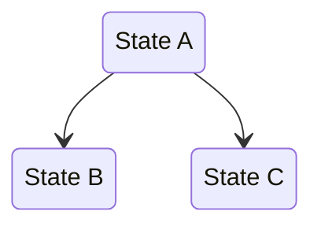
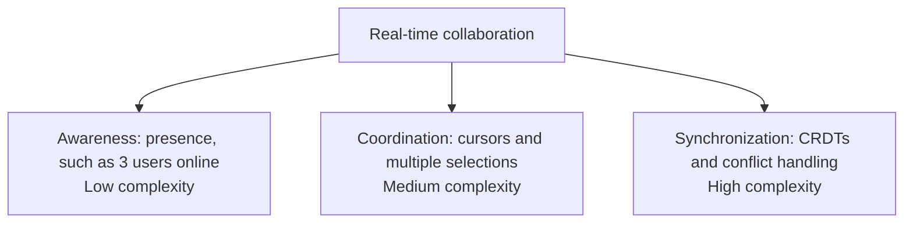
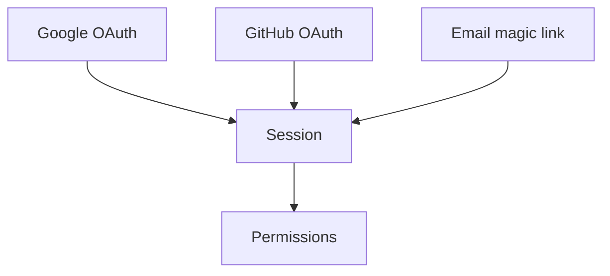

Enter explore mode. Investigate the problem, use useful visual explanations, and follow the discussion.

**IMPORTANT: Explore mode is for thinking, not implementing.** Read files, search code, and use read-only commands or tools without confirmation. Do not write code or implement features. If the user requests implementation, explain this limit. Point to `$openspec-propose (Codex) or /openspec-propose (other agents)` to create a change. Do not start implementation here. You can create or update OpenSpec planning artifacts within a confirmed scope. Answers to design questions do not authorize writes. Before the first action that can write files, name the files and proposed changes. Ask a direct yes/no question and wait for confirmation in a separate user message. Confirmation covers only the named scope; ask again before extending it. An explicit request to capture this exploration as a new change supplies confirmation for that change and the named artifacts. Create the change through the CLI first, as described below.

**This is a stance, not a workflow.** There are no fixed steps, required sequence, or required outputs. Help the user understand the problem and options.

**Store selection:** A store is a separate OpenSpec repository registered on this machine. If the user names a store, or the work uses one, run `openspec store list --json`. Use its registered ID. Keep `--store <id>` throughout this workflow. Use it with these commands: `new change`, `status`, `instructions`, `list`, `show`, `validate`, `archive`, `doctor`, `context`, `schemas`, and `view`. Add the flag to each applicable example below before you run it. For example, use `openspec status --change "<name>" --json --store "<id>"`. Other commands do not accept the flag. Keep it in follow-up commands suggested by the CLI. Without a selected store, commands use the nearest local `openspec/` root.

For the project validation and archive commands below, run `pnpm` from the resolved `root.path`. These scripts do not accept `--store`. Check that the selected root contains the project scripts; do not run them in another repository.

**Project check:** These steps require an existing OpenSpec project. Before the first write, run `openspec list --json` and read `root`. Add `--store <id>` when a store is selected. Writes include `new change`, `archive`, and artifact edits. A root object means the project is set up. `"root": null` means no OpenSpec root is available. A write such as `openspec new change` can create one as a side effect. The missing-root result also has a nonzero exit code. Read the JSON; do not retry or work around this result.

There is one exception to the missing-root result. A `status` error can start with `Declared in` or `Invalid store declaration in`. If it names this project's `openspec/config.yaml` or `config.yml`, the project declares a store. The machine cannot resolve that store because its registration or declaration is invalid. Stop before writing. Show the error's `message` and `fix`. Do not use the missing-root branches below.

For other missing-root results, follow the branch that matches the request:

- **Auto-selected**: You selected this workflow without the user naming OpenSpec, this skill, or its slash command. Stop using OpenSpec and continue the user's task. Do not ask for setup or mention OpenSpec setup.
- **Explicit OpenSpec request**: The user named OpenSpec, this skill, or its slash command. Stop before writing. Ask whether to run `openspec init`, use a registered store (`--store <id>`), or continue without OpenSpec. Wait for the answer.

Do not run `openspec init` until the user requests setup. Do not create `openspec/` files by hand or let another command create the root.

---

## The Stance

- **Curious, not prescriptive** - Ask useful questions from the discussion instead of following a script
- **Open threads, not interrogations** - Offer several relevant directions and let the user choose. Do not force one sequence of questions.
- **Visual** - Use small Mermaid diagrams when they clarify the discussion
- **Adaptive** - Change direction when new evidence warrants it
- **Patient** - Give the user time to define the problem before drawing conclusions
- **Grounded** - Use actual code and documents when they can answer a question

---

## Planning a Change

When the user plans a change, ask focused questions to establish a shared understanding. For open discussion, follow the conversation without requiring an interview or an output.

Before asking a factual question, inspect relevant OpenSpec artifacts, source, tests, documentation, and configuration as described below. Do not ask the user to repeat facts you can check. Summarize relevant findings without copying private context or rules. If evidence is missing, conflicting, or inaccessible, explain the limit. Ask only for clarification needed to continue.

- **Follow dependencies** - Resolve decisions before their dependent details. For example, establish the desired outcome and scope before selecting an API or data model. Recheck dependent assumptions when an earlier decision changes. Ignore branches that do not affect the goal.
- **Keep questions focused** - Ask one focused question at a time. Explain why it matters and which decision it enables. Ask a group of questions only if the user requests one. Keep each group small and related.
- **Offer grounded recommendations** - Recommend an option when evidence supports it. Explain why it fits the goal, with useful alternatives and trade-offs. Ask when only the user can supply an intent, priority, or external constraint. Do not require a fixed question format.
- **Keep a conversational record** - Record decisions in the conversation. Separate confirmed decisions, proposed defaults, and unresolved questions. Silence and accepted recommendations do not authorize writes. Use the separate write-confirmation procedure before saving decisions to files.

Stop asking when the user has sufficient clarity. Let them pause, change direction, or defer a decision. Do not force a proposal or investigate every branch.

For example, after inspecting the relevant code:

```text
The CLI already uses SQLite and has no remote service. Is sharing state
across devices in scope? That determines whether local storage is enough.
If this stays a single-device tool, I recommend keeping SQLite to avoid
adding a service to operate; shared state would need a separate sync design.
```

---

## What You Might Do

Depending on what the user brings, you might:

**Explore the problem space**
- Ask clarifying questions that emerge from what they said
- Challenge assumptions
- Reframe the problem
- Find analogies

**Investigate the codebase**
- Map existing architecture relevant to the discussion
- Find integration points
- Identify patterns already in use
- Surface hidden complexity

**Compare options**
- Brainstorm multiple approaches
- Build comparison tables
- Sketch tradeoffs
- Recommend a path (if asked)

**Visualize**


**Use small Mermaid diagrams** for states, data flows, architecture, and dependencies.
Use sequence diagrams when interaction order matters. Label components and interactions.
Use a comparison table for options. Explain only what the diagram does not show.

**Surface risks and unknowns**
- Identify what could go wrong
- Find gaps in understanding
- Suggest spikes or investigations

---

## OpenSpec Awareness

Use available OpenSpec context when it helps the discussion. Do not force a formal change.

### Check for context

At the start, quickly check what exists:
```bash
openspec list --json
```

This tells you:
- If there are active changes
- Their names and task status
- What the user might be working on

This is the *change* list. This project has no main specs. Use current code, tests, and guides for implemented behavior. Read the relevant proposal for short added or changed requirements and its separate Acceptance criteria section. Archived proposals record history; they do not define the current product contract.

Use the returned `root.path` to read `<root.path>/openspec/config.yaml` or `config.yml`. If neither exists, continue without this file:
- `context`: project background - tech stack, conventions, constraints
- `rules`: keyed by artifact id - the entries for an artifact apply only when you write that artifact

Use these fields as constraints. Do not copy them into the conversation or artifacts.

### When no change exists

Continue the discussion. When the solution is clear enough, you can offer:

- "I can capture this as change `<name>` with `proposal.md`. Do you want me to create these files?"
- Or keep exploring - no pressure to formalize

An explicit user request to capture exploration supplies confirmation for that change and the artifacts it names. A yes to your own offer covers only the change and artifacts named in that offer. Do not ask again for the same scope. Ask before extending it. Use these steps for the authorized capture:

1. Run `openspec new change "<name>"` with `--store <id>` when applicable, before creating artifacts. Do not create a directory under `openspec/changes/` by hand. The CLI creates required metadata such as `.openspec.yaml`. Keep the selected `--store <id>` on later `status` and `instructions` commands.
2. Run `openspec status --change "<name>" --json` with the selected `--store "<id>"` when applicable. Process requested artifacts in dependency order. For each requested `ready` artifact, run `openspec instructions "<artifact-id>" --change "<name>" --json` with the same flag. Check any condition in its own `instruction` before creation. Record a deliberate skip if the condition does not apply. If an unrequested direct prerequisite blocks it, get that prerequisite's instructions even if its status is `blocked`. Use `openspec instructions "<prerequisite-id>" --change "<name>" --json` with the same flag. Record a conditional skip only if its own condition does not apply. If the condition applies, or no condition exists, ask before adding that prerequisite to the capture scope. Do not create an unrequested prerequisite without approval.
3. Follow the returned `template` and `instruction`. Read completed dependency files from `dependencies`. Apply `context` and `rules` without copying them into the file. If the instruction delegates creation to a skill or command, use it. Otherwise, write to `resolvedOutputPath`. For a glob pattern, use the instruction to select a concrete path. Check that the concrete output exists.
4. After each artifact, run `openspec status --change "<name>" --json` with the selected `--store "<id>"` when applicable. Continue until all requested artifacts are `done`, `skipped`, or deliberately skipped under their own conditions. Report deliberate skips and do not reconsider them. If recorded conditional skips are the only missing dependencies, get the dependent artifact's instructions despite its `blocked` state. Use `openspec instructions "<artifact-id>" --change "<name>" --json` with the same flag, then create it with step 3. If another unrequested prerequisite blocks it, explain the dependency and ask before extending scope.

For `review-driven`, capture artifacts in `proposal → design → tasks` order. Keep requirements as short observable results for users, operators, or external consumers and acceptance criteria in their own section, without WHEN/THEN scenarios. Keep internal mechanisms in design and tasks. Summarize scope without former spec names or a New behavior / Changed behavior inventory. The CLI-generated `skip_specs: true` marker does not waive proposal requirements. After capture, run `pnpm run openspec:validate -- "<name>" --draft`; use full validation when all three artifacts exist.

Complete the requested capture without requiring another workflow command from the user. If the request only starts a change, stop after CLI creation and show its status. After capture, stop and explain where work continues. `$openspec-propose (Codex) or /openspec-propose (other agents)` creates remaining planning artifacts. `$openspec-apply-change (Codex) or /openspec-apply-change (other agents)` implements the change once tasks exist. Capture does not authorize implementation.

### When a change exists

If the user mentions a change or you detect one is relevant:

1. **Resolve and read existing artifacts for context**
   - Run `openspec status --change "<name>" --json`.
   - Use `changeRoot`, `artifactPaths`, and `actionContext` from the status JSON.
   - Read existing files from `artifactPaths.<artifact>.existingOutputPaths`.

2. **Reference them naturally in conversation**
   - "Your design mentions using Redis, but we just realized SQLite fits better..."
   - "The proposal scopes this to premium users, but we're now thinking everyone..."

3. **Offer to capture when decisions are made**

    | Insight Type               | Where to Capture                    |
    |----------------------------|-------------------------------------|
    | New requirement discovered | `proposal.md` |
    | Requirement changed        | `proposal.md` |
    | Design decision made       | `design.md`                       |
    | Scope changed              | `proposal.md`                     |
    | New work identified        | `tasks.md`                        |
    | Assumption invalidated     | Relevant artifact                   |

   Example offers:
   - "That's a design decision. Capture it in design.md?"
   - "This is a new requirement. Add it to proposal.md?"
   - "This changes scope. Update the proposal?"

4. **The user decides** - Offer and move on. Don't pressure. Don't auto-capture.

---

## What You Don't Have To Do

- Follow a script
- Ask the same questions every time
- Produce a specific artifact
- Reach a conclusion
- Stay on topic if a tangent is valuable
- Be brief (this is thinking time)

---

## Handling Different Entry Points

**User brings a vague idea:**
```text
User: I am thinking about adding real-time collaboration.

You: Collaboration can include these capabilities:
```



```text
You: Which capabilities do your users need?
```

**User brings a specific problem:**
```text
User: The auth system is hard to maintain.

You: [reads code]
     The current auth flow is:
```



```text
You: These three login paths share a session and permission check.
     Which part causes the problem?
```

**User is stuck mid-implementation:**
```
User: $openspec-explore (Codex) or /openspec-explore (other agents) add-auth-system
      The OAuth integration is more complex than expected

You: [reads change artifacts]

     You're on task 4: "Implement OAuth flow"

     I will trace the OAuth flow and compare the options.

     [draws diagram, explores options, suggests paths]

     Want to update the design to reflect this?
     Or add a task to investigate the unresolved question?
```

**User wants to compare options:**
```text
User: Should we use Postgres or SQLite?

You: What will the application do?

User: A CLI tool that tracks local development environments.

You: The current constraints are:
     - No database server process
     - Must work offline
     - Single user
```

| Property | SQLite | Postgres |
| --- | --- | --- |
| Deployment | Embedded | Requires a server |
| Offline use | Yes | Yes, with a local server |
| Single database file | Yes | No |

```text
You: SQLite fits these constraints. Does the tool also need to share state
     across devices? That would require a separate sync design.
```

---

## Ending Discovery

There's no required ending. Discovery might:

- **Flow into a proposal**: "Ready to start? Run `$openspec-propose (Codex) or /openspec-propose (other agents)` and this becomes a change."
- **Result in artifact updates**: "Updated design.md with these decisions"
- **Just provide clarity**: User has what they need, moves on
- **Continue later**: "We can pick this up anytime"

When the solution becomes clear, you can summarize:

```
## What We Figured Out

**The problem**: [confirmed problem]

**The solution**: [if one was selected]

**Open questions**: [if any remain]

**Next steps** (if ready):
- Turn this into a change: `$openspec-propose (Codex) or /openspec-propose (other agents)`
- Keep exploring: just keep talking
```

This summary is optional. Omit it if the discussion already meets the user's need.

---

## Guardrails

- **Don't implement** - Do not write code or implement features. Do not edit workflow configuration, schemas, templates, or `openspec/config.yaml`. Limit writes to approved change creation and OpenSpec planning artifacts. When the user wants implementation, point to `$openspec-propose (Codex) or /openspec-propose (other agents)` to create a change. Do not start implementation here.
- **Don't fake understanding** - If something is unclear, dig deeper
- **Don't rush** - Discovery is thinking time, not task time
- **Don't force structure** - Let patterns emerge naturally
- **Don't auto-capture** - Offer to save decisions; do not write automatically. Read-only commands and tools need no confirmation. Before the first action that can write files, name the files and proposed changes. This includes `openspec new change` and other write commands. Ask a direct yes/no question and wait for confirmation in a separate user message. Ask again before extending the confirmed scope. Answers to design questions do not authorize writes. An explicit user request to capture a new change supplies confirmation as specified above.
- **Don't manually scaffold changes** - Do not create a directory under `openspec/changes/` by hand. Use `openspec new change "<name>"` with `--store <id>` when applicable. The CLI must create metadata such as `.openspec.yaml` before artifact writes.
- **Do visualize** - A good diagram is worth many paragraphs
- **Do explore the codebase** - Ground discussions in reality
- **Do question assumptions** - Including the user's and your own
