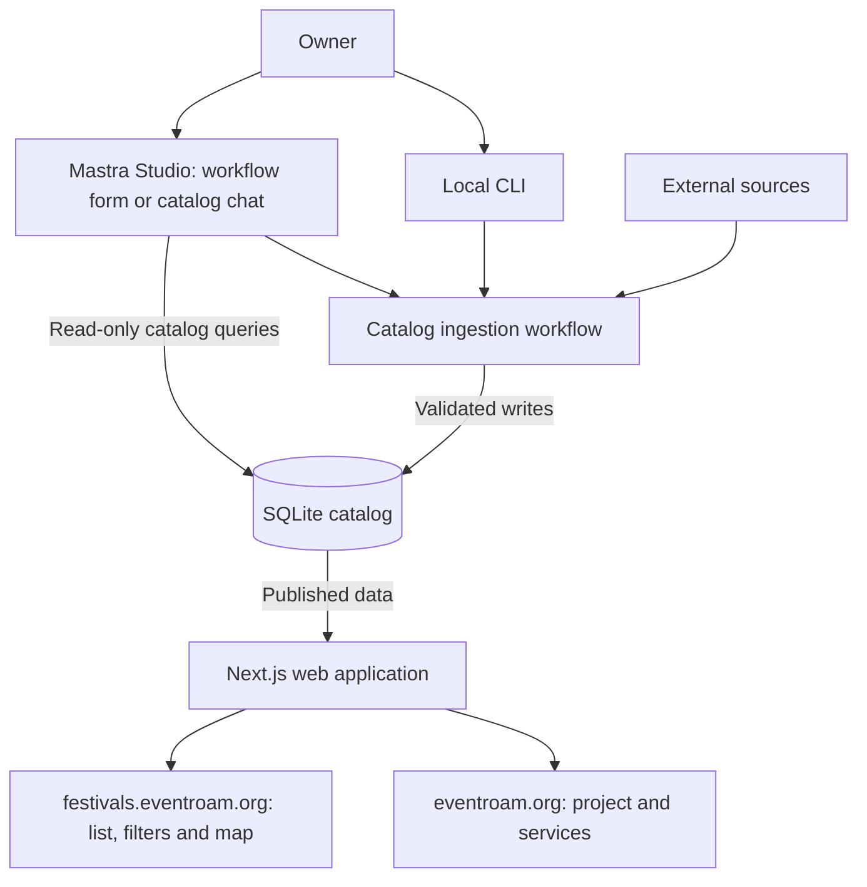
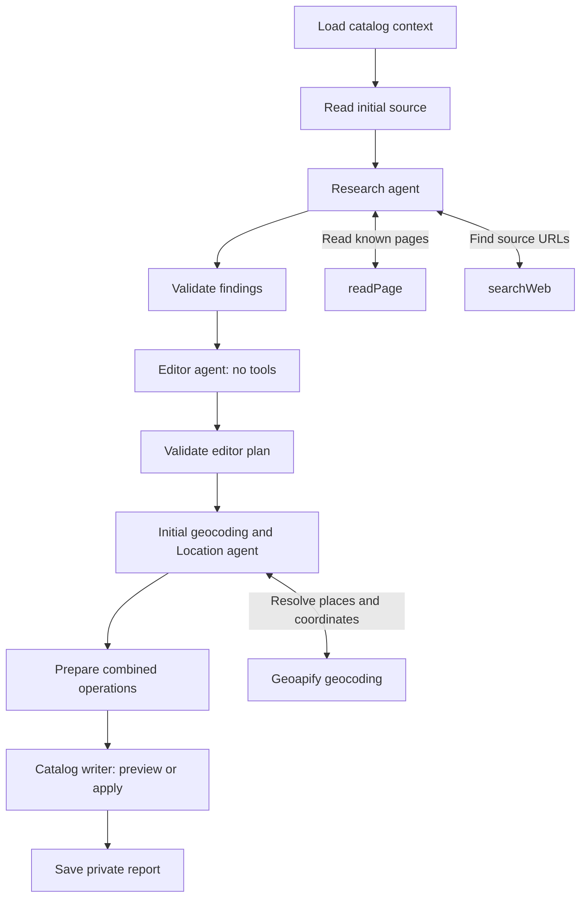

# Eventroam

Eventroam helps keep event information up to date through AI-assisted source research and validated catalog updates.

**Status:** live in production and under active development.

- [eventroam.org](https://eventroam.org) — project overview and services.
- [festivals.eventroam.org](https://festivals.eventroam.org) — festival discovery and event details.

## Product idea

Bring scattered announcements and event details into one catalog that helps people discover events using current, source-backed information. Track each event across editions, updating plans as new information appears while preserving its history.

## Architecture

Eventroam uses one Next.js application and one SQLite catalog. The apex site presents the data collection system, a festival catalog example, and services for data collection and custom system development. The Festivals site serves discovery and event details from the catalog. Separate web and Studio containers share the catalog database.



The website reads published catalog data. The owner starts ingestion through the local CLI, local Studio, or hosted Studio. Studio chat can select Events, start refreshes, and inspect saved results. The web application does not run ingestion.

## Ingestion

The Mastra workflow separates source research, editing, location resolution, and catalog writes.



Research uses saved facts, links, and vocabulary as context. It reads known pages and searches when permitted. Search results must be read before their facts can be used. The editor chooses field actions from findings and saved context. The Location agent resolves place fields and coordinates. The writer validates the combined operations and commits changes in one transaction per Event. Preview runs save a report without retaining catalog changes.

Studio chat can query the catalog through a read-only SQL tool and refresh one to three selected Events in sequence. Each Event uses a new workflow run. Preview is the default; an explicit owner update request permits apply. Refreshes are started by the owner; there is no scheduled refresh.

## Technology and approach

| Area | Current choice |
| --- | --- |
| Web | Next.js App Router, React, TypeScript, Node.js |
| Data | SQLite, Drizzle ORM, `better-sqlite3` |
| UI and map | Tailwind CSS, Mapbox GL JS |
| AI agents | Mastra workflows and Studio chat; OpenRouter for ingestion |
| Source processing | Got, Cheerio, Turndown; optional Firecrawl fallback |
| Geocoding | Geoapify |
| Runtime | Separate web and Studio containers with a shared catalog volume |
| Validation and quality | Zod, ESLint, Prettier, Vitest, Playwright |

Run `npm run type-check`, `npm run lint`, `npm test`, and `npm run build` for application checks.

## Documentation

- [Development guide](docs/development.md) — environment setup, commands, testing, and local Studio.
- [Ingestion process](docs/ingestion-process.md) — workflow, source rules, and reports.
- [Project structure](docs/project-structure.md) — code layout and dependency boundaries.
- [OpenSpec](openspec/specs/) — implemented behavior; [active changes](openspec/changes/) describe approved future work.
- [Documentation index](docs/index.md) — decisions, deployment gates, and research.

## License

Proprietary. All rights reserved. See [LICENSE](LICENSE).

## Run locally

Requires Node.js **26.11.1** and npm **11.20.0**.

```sh
npm ci
npm run db:fixtures
npm run dev
```

Open [localhost:3000](http://localhost:3000) for the project presentation or [festivals.localhost:3000](http://festivals.localhost:3000) for festivals. Mapbox is optional. See the [development guide](docs/development.md) for configuration, ingestion, and application Compose commands.
