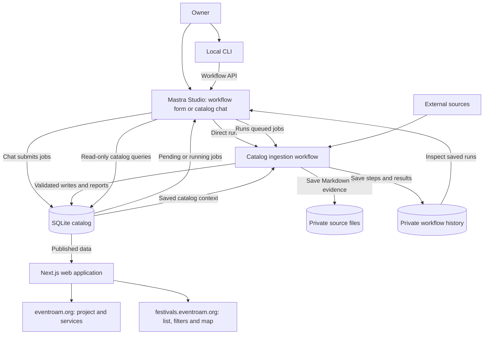

# Eventroam

Eventroam helps keep event information up to date through AI-assisted source research and validated catalog updates.

**Status:** live in production and under active development.

- [eventroam.org](https://eventroam.org/?utm_source=github&utm_medium=readme&utm_campaign=eventroam&utm_content=eventroam) — project overview and services.
- [festivals.eventroam.org](https://festivals.eventroam.org) — festival discovery and event details.

## Product idea

Bring scattered announcements and event details into one catalog that helps people discover events using current, source-backed information. Track each event across editions, updating plans as new information appears while preserving its history.

## Architecture

Eventroam uses one Next.js application and one SQLite catalog. The apex site presents the data collection system, a festival catalog example, and services for data collection and custom system development. The Festivals site serves discovery and event details from the catalog. Separate web and Studio containers share the catalog database.



The website reads published data. Studio runs ingestion and keeps source evidence, run history, and reports in private storage.

## Ingestion

The owner starts research through the CLI or Studio. The workflow reads sources and collects evidence before it proposes catalog changes. Editor reviews those proposals before the catalog writer validates and applies them. Preview is the default. An explicit apply request allows catalog writes.

See the [ingestion process](docs/ingestion-process.md) for the workflow and report checks. See [ingestion tools](docs/ingestion-tools.md) for CLI, Studio, and job queue instructions.

## Technology and approach

| Area                   | Current choice                                                  |
| ---------------------- | --------------------------------------------------------------- |
| Web                    | Next.js App Router, React, TypeScript, Node.js                  |
| Data                   | SQLite, Drizzle ORM, `better-sqlite3`                           |
| UI and map             | Tailwind CSS, Mapbox GL JS                                      |
| AI agents              | Mastra workflows and Studio chat; OpenRouter for ingestion      |
| Source processing      | Got, Cheerio, `@mdream/js`; optional Firecrawl fallback         |
| Geocoding              | Geoapify                                                        |
| Analytics              | PostHog                                                         |
| Runtime                | Separate web and Studio containers with a shared catalog volume |
| Validation and quality | Zod, ESLint, Prettier, Vitest, Playwright                       |

See [common checks](docs/development.md#common-checks) before submitting a change.

## Documentation

- [Development guide](docs/development.md) — environment setup, commands, testing, and local Studio.
- [Ingestion process](docs/ingestion-process.md) — workflow, source rules, and reports.
- [Project structure](docs/project-structure.md) — code layout and dependency boundaries.
- [Change workflow](docs/change-workflow.md) — [active changes](openspec/changes/) use proposal, design, and tasks; proposals hold short requirements and acceptance criteria, and archives record past work.
- [Documentation index](docs/index.md) — current guides and historical records.

## License

[PolyForm Noncommercial 1.0.0](LICENSE.md)

## Run locally

Use the Node.js and pnpm versions in [local setup](docs/development.md#local-setup).

```sh
pnpm install --frozen-lockfile
pnpm run db:fixtures
pnpm run dev
```

Open [localhost:3000](http://localhost:3000) for the project presentation or [festivals.localhost:3000](http://festivals.localhost:3000) for festivals. Mapbox is optional. See the [development guide](docs/development.md) for local configuration and [Infrastructure](docs/infrastructure.md#application-containers) for Compose commands.
