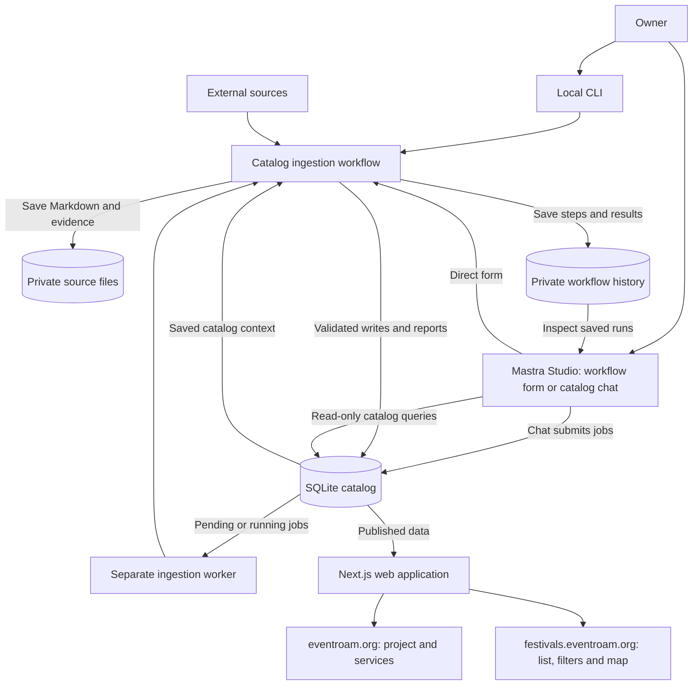
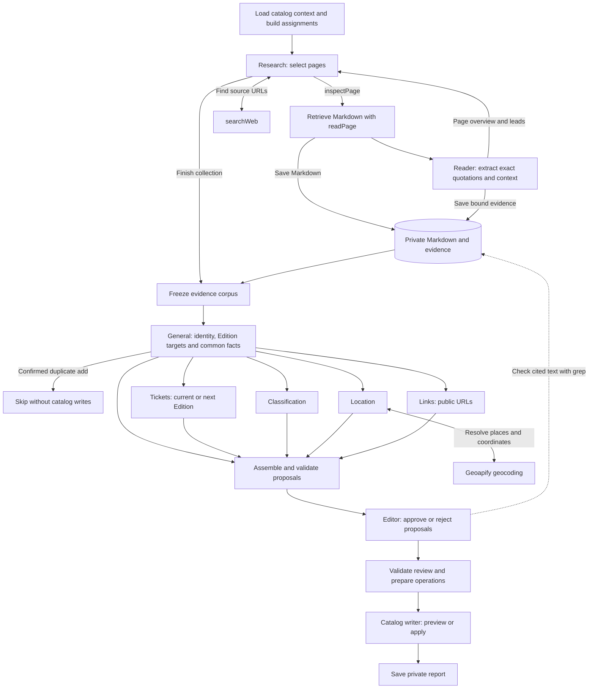

# Eventroam

Eventroam helps keep event information up to date through AI-assisted source research and validated catalog updates.

**Status:** live in production and under active development.

- [eventroam.org](https://eventroam.org/?utm_source=github&utm_medium=readme&utm_campaign=eventroam&utm_content=eventroam) — project overview and services.
- [festivals.eventroam.org](https://festivals.eventroam.org) — festival discovery and event details.

## Product idea

Bring scattered announcements and event details into one catalog that helps people discover events using current, source-backed information. Track each event across editions, updating plans as new information appears while preserving its history.

## Architecture

Eventroam uses one Next.js application and one SQLite catalog. The apex site presents the data collection system, a festival catalog example, and services for data collection and custom system development. The Festivals site serves discovery and event details from the catalog. Separate web, Studio, and worker containers share the catalog database.



The website reads published catalog data. The owner starts ingestion through the local CLI, local Studio, or hosted Studio. Studio chat selects Events and saves refresh jobs. The worker processes those jobs independently of Studio. Chat reads progress and saved results through catalog SQL. The Studio workflow view shows saved steps and results. Source Markdown and evidence remain in private files until explicit cleanup. The web application does not run ingestion.

## Ingestion

The Mastra workflow collects evidence, proposes changes, and reviews them before a catalog write. The diagrams reflect the current branch and its [source-evidence change](openspec/changes/source-evidence-ingestion/). Final model-quality checks and the remaining spec updates are still open.



Code loads saved facts, links, and vocabulary and builds concrete assignments. The workflow inspects an initial saved source when available. Research selects further pages and searches when permitted. Reader extracts exact quotations and context from each admitted full page. Code binds them to saved Markdown. Page overviews and search results guide navigation; changes require source evidence.

After collection, all interpretation roles use the same fixed evidence corpus and relevant saved facts. General confirms identity, selects Edition targets, and proposes common facts. A confirmed duplicate add stops here. Tickets, Classification, Location, and Links then run in parallel. Location resolves places and coordinates before Editor review. Tickets covers only the current or next Edition, including an ongoing Edition; historical ticket data stays unchanged. Links selects public URLs independently of ticket prices.

Code assembles the proposals. Editor approves or rejects them and can check cited source text with grep. It cannot replace proposed values. Code validates the review and prepares catalog operations. The writer validates those operations and commits changes in one transaction per Event. A required role failure prevents catalog writes. Preview runs save a report without retaining catalog changes.

Studio chat can submit one fixed selection of up to 200 Events and return its batch ID. One worker per catalog processes jobs in order. Preview is the default; an explicit owner update request permits apply. The owner can cancel pending jobs. After a worker restart, pending and saved running jobs start from the beginning with new workflow runs. Earlier reports and commits remain available. The owner starts every batch.

## Technology and approach

| Area                   | Current choice                                                           |
| ---------------------- | ------------------------------------------------------------------------ |
| Web                    | Next.js App Router, React, TypeScript, Node.js                           |
| Data                   | SQLite, Drizzle ORM, `better-sqlite3`                                    |
| UI and map             | Tailwind CSS, Mapbox GL JS                                               |
| AI agents              | Mastra workflows and Studio chat; OpenRouter for ingestion               |
| Source processing      | Got, Cheerio, `@mdream/js`; optional Firecrawl fallback                  |
| Geocoding              | Geoapify                                                                 |
| Analytics              | PostHog                                                                  |
| Runtime                | Separate web, Studio, and worker containers with a shared catalog volume |
| Validation and quality | Zod, ESLint, Prettier, Vitest, Playwright                                |

Run `pnpm run type-check`, `pnpm run lint`, `pnpm test`, and `pnpm run build` for application checks.

## Documentation

- [Development guide](docs/development.md) — environment setup, commands, testing, and local Studio.
- [Ingestion process](docs/ingestion-process.md) — workflow, source rules, and reports.
- [Project structure](docs/project-structure.md) — code layout and dependency boundaries.
- [OpenSpec](openspec/specs/) — implemented behavior; [active changes](openspec/changes/) describe approved future work.
- [Documentation index](docs/index.md) — decisions, infrastructure, and research.

## License

[PolyForm Noncommercial 1.0.0](LICENSE.md)

## Run locally

Requires Node.js **26.11.1** and pnpm **12.15.0**. Install pnpm with `npm install --global pnpm@12.15.0`.

```sh
pnpm install --frozen-lockfile
pnpm run db:fixtures
pnpm run dev
```

Open [localhost:3000](http://localhost:3000) for the project presentation or [festivals.localhost:3000](http://festivals.localhost:3000) for festivals. Mapbox is optional. See the [development guide](docs/development.md) for configuration, ingestion, and application Compose commands.
