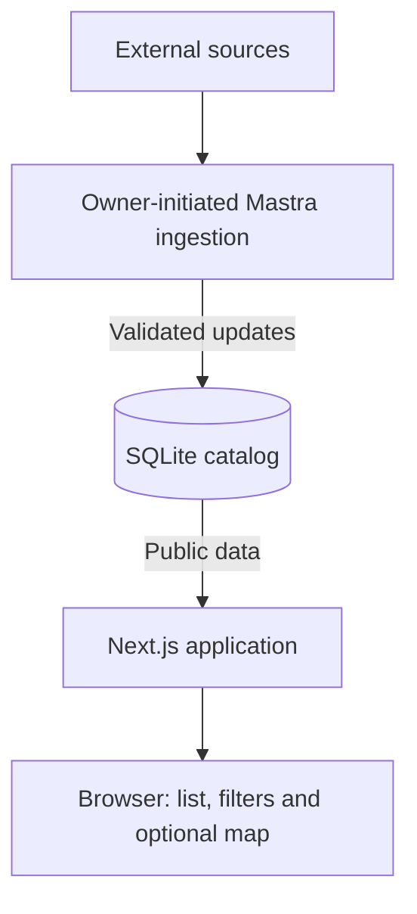
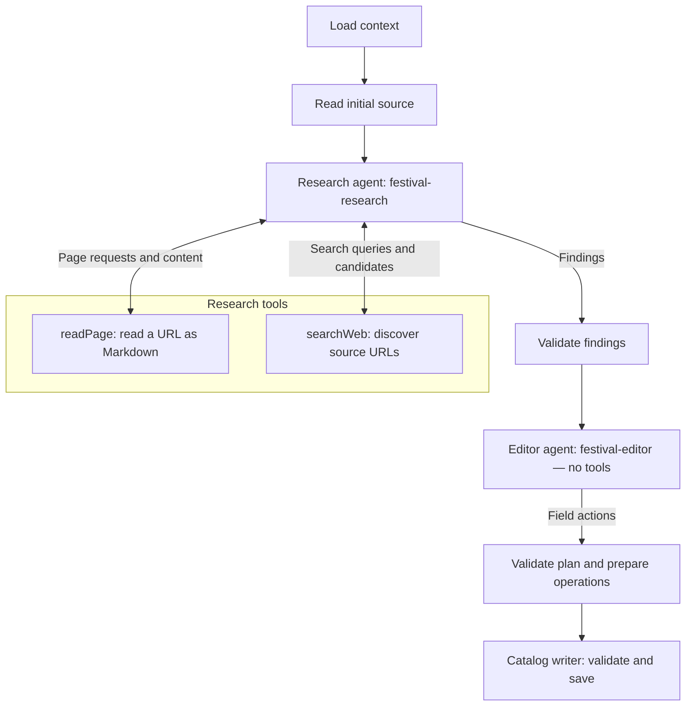

# Eventroam

Eventroam helps keep event information up to date through AI-assisted source research and validated catalog updates.

**Status:** active development, fictional demo data, no production deployment.

## Product idea

Bring scattered announcements and event details into one catalog that helps people discover events using current, source-backed information. Track each event across editions, updating plans as new information appears while preserving its history.

## Run locally

Requires Node.js **26.11.1** and npm **11.20.0**.

```sh
npm ci
npm run db:fixtures
npm run dev
```

Open [localhost:3000](http://localhost:3000) for the project presentation or [festivals.localhost:3000](http://festivals.localhost:3000) for festivals. Mapbox is optional. See the [development guide](docs/development.md) for configuration, ingestion, and application Compose commands.

## Architecture

Eventroam is one Next.js application and one SQLite catalog. The apex host presents the data collection system, its festival catalog example, and two services: data collection and custom system development. It links to the author's LinkedIn profile for discussion. The Festivals host serves discovery and record pages from the shared catalog.



The website reads published catalog data. An owner runs ingestion through the local CLI, loopback Studio, or hosted Studio to research sources and save validated changes.

## Ingestion

The Mastra workflow separates source research, editing, and catalog writes.



Research uses saved facts, links, and vocabulary as context, follows known links with `readPage`, and searches when permitted. Search candidates must be read before using their facts. The editor chooses field actions from findings and saved context without tools. The writer validates and commits changes atomically per Event.

## Technology and approach

| Area | Current choice |
| --- | --- |
| Web | Next.js App Router, React, TypeScript, Node.js |
| Data | SQLite, Drizzle ORM, `better-sqlite3` |
| UI and map | Tailwind CSS, Mapbox GL JS |
| AI agents | Mastra, OpenRouter, GPT-6 Luna by default |
| Source processing | Got, Cheerio, Turndown |
| Validation and quality | Zod, ESLint, Prettier, Vitest, Playwright |

Run `npm run type-check`, `npm run lint`, `npm test`, and `npm run build` for application checks.

## Documentation

- [Development guide](docs/development.md) — environment setup, commands, testing, and local Studio.
- [Ingestion process](docs/ingestion-process.md) — workflow, source rules, and reports.
- [Project structure](docs/project-structure.md) — code layout and dependency boundaries.
- [OpenSpec](openspec/specs/) — implemented behavior; [active changes](openspec/changes/) describe approved future work.
- [Documentation index](docs/index.md) — decisions, progress, deployment gates, and research.

## License

Proprietary. All rights reserved. See [LICENSE](LICENSE).
