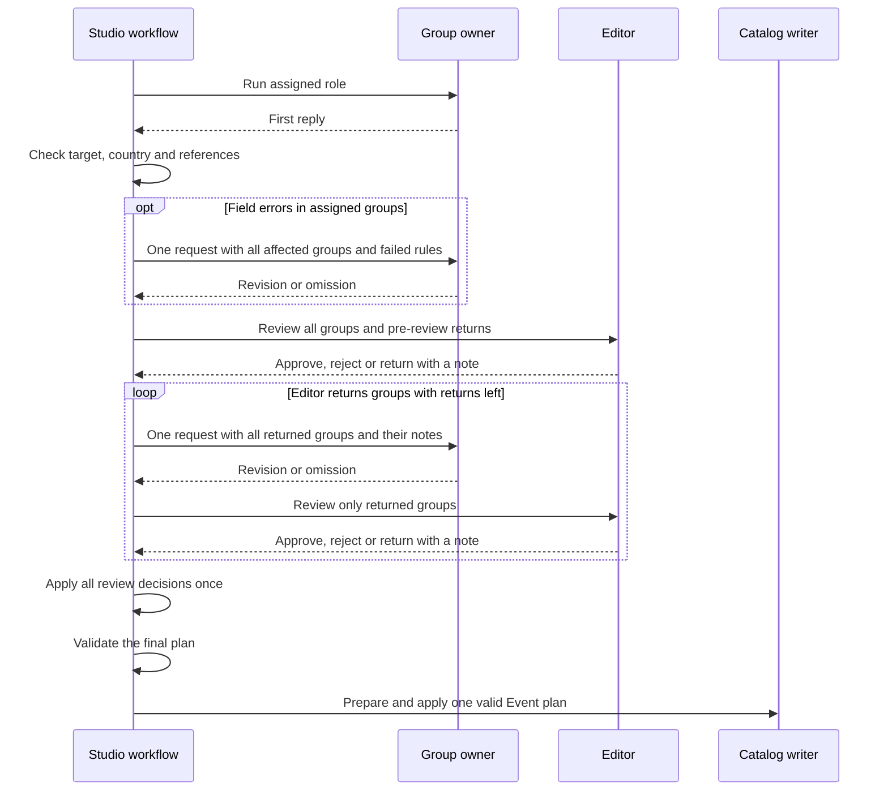

# Design

## TL;DR

- **Result.** Editor approves, rejects or returns a group with a note. Only the group owner can revise a value or fill an omission.
- **Flow.** After the item checks pass, validation can return any field error that it can link to an assigned group. Each round sends one return request per owner. Validation can use the first of three returns per group. Editor reviews editorial returns separately and can use any remaining returns. The workflow applies all decisions together after review.
- **Limits.** The Event and Edition selection stay fixed. Repairs use saved pages. The Studio workflow prepares one validated plan for the Event and saves the repair decisions in the private report. [Proposal](proposal.md) · [Workflow rules](specs/catalog/ingestion-workflow/spec.md)

## Contracts

**Editor review.** The reply has one field, `decisions`, with a flat list of entries. Editor puts its comments in the decision notes. Keep the specialists' `unresolved` questions in the report. [Current review schema](../../../src/ingestion/proposals.ts#L549)

```ts
// Proposed entry in the decisions list.
type ReviewDecision = {
  path: string;
  decision: "approve" | "reject" | "return";
  note: string;
};
```

In the first review, require a decision for the item, each selected target, each submitted group and each returned omission. For any other assigned omission, include an entry only to request a return. Item and target decisions and decisions on groups at the return limit allow approval or rejection. The targeted review requires a decision for each returned group or omission. Reject extra fields, including replacement values.

Tell Editor to request a return when saved evidence points to a change or when the owner can answer a specific question from saved pages. Ask for that question or finding in the note. The note can include source references and excerpts. Validate that the note is nonblank and preserve its text as written. A note is a lead for the owner. Only the owner's verified citations support the revised value.

**Review paths.** Use the assigned group lookup to give Editor the paths it can use and to validate its decisions. Use `item`, `event.target` and paths such as `currentOrNextEdition.target` for the item and targets. Keep item and Event decisions separate for the add-batch report. Match field paths to complete groups in the assignment. For example, `currentOrNextEdition.fields.tickets` is the price block and `currentOrNextEdition.fields.links.tickets` is the public link. Reject duplicate paths, missing required decisions and paths outside the review. Use the same group path for the return allowance. Resolve the Event or Edition key from the fixed target when building the report. [Group ownership](specs/catalog/ingestion-updates/spec.md) · [Add-batch report query](../../../src/mastra/catalog-assistant/skills/catalog-sql/references/inspect-add-batch.sql)

**Omission reason.** When the owner leaves out a returned optional group, use an existing `unresolved` entry to explain why. Its `field` must match the exact group path. Use its `message` in the Editor review and the private repair record.

**Ownership.** General owns its fields within the fixed target. Classification owns `event.fields.description` and `event.fields.shortDescription` as separate groups on add and full refresh, as well as classification for each selected Edition. Each description keeps its existing content and review rules. Current refresh assigns neither Event description nor shared links. Dates, prices, classification and each Edition's place use complete groups. Each public link has its own group. [Proposal assembly](../../../../src/ingestion/proposals.ts) · [Description rules](../../specs/catalog/ingestion-workflow/spec.md#requirement-each-description-can-stand-on-its-own) · [Refresh scope](../../specs/catalog/refresh-scope/spec.md)

## Architecture

CLI, Studio form and queued jobs use the same workflow in Studio. Keep the existing context and Edition gates before specialist work. A conflict between saved countries stops refresh at context loading. An evidence-backed country conflict from General stops before the Edition gate, even when General selects no Edition. After the gates pass, the assignment determines which groups can be repaired. An Event-only assignment allows only Event groups. [Workflow](../../../src/ingestion/workflow.ts) · [Country rule](../../specs/catalog/refresh-scope/spec.md#requirement-country-conflicts-veto-the-whole-event-refresh) · [Studio execution](../../../docs/ingestion-tools.md#background-execution)



**Check the whole reply before using it.** Reuse the checks for target, assignment, country, identity and source, evidence, term and point references. Check references in every check finding. Apply the existing scope rules when those findings contribute to coverage. Run these checks on the original structured answer even when local validation failed. Apply General's country guard to its country findings before deciding if a field error can be repaired. Check each revision before selecting the requested values. A terminal error or an incomplete item check stops the item. Keep the existing failure path for a provider failure, refusal or unusable reply. Group returns revise completed replies. The existing provider recovery rule still governs failed requests. [Workflow checks](specs/catalog/ingestion-workflow/spec.md) · [Provider recovery](../../specs/catalog/ingestion-workflow/spec.md#requirement-provider-unavailability-has-bounded-recovery)

**Confirm General's targets before a return.** Validate identity, country, Edition keys and temporal roles before dispatch. Use the existing target checks on the usable selection facts even if a separate field such as the size estimate fails. If a date error makes a selected role invalid or leaves the role check inconclusive, stop the item. A General return can revise fields only within a confirmed role. [General validation](../../../../src/ingestion/roles/general/validate-targets.ts)

**Route validation errors by group.** Keep issue paths and rule codes from the role schemas. For field checks in proposal assembly and Location validation, keep the affected group and rule before producing report text. Check that all references exist first. A missing citation for a field can be a group issue when the item checks pass. An unknown reference stops the item. Use the same group lookup for validation, returns and review. The Tickets and Links responses both use `currentOrNextEdition.tickets`, but the review has a separate path for each group. Collect field issues across all assigned groups after the item checks. Stop the item if any issue cannot be assigned or a group still fails after its return. Send all failed rules for a group in the same return. This includes excess known classification terms. Give Classification the facet, limit and conflicting IDs. Emit the required count diagnostic if the revision still exceeds the limit. [Role checks](../../../src/ingestion/roles/invoke.ts#L112) · [Assembly](../../../../src/ingestion/proposals.ts) · [Location validation](../../../../src/ingestion/roles/location/validate.ts#L182) · [Classification rule](specs/catalog/classification/spec.md#requirement-classification-revises-lists-with-excess-facet-terms) · [Count diagnostic](specs/catalog/ingestion-runs/spec.md#requirement-classification-count-errors-identify-the-conflict)

**Batch returns by owner and merge by path.** Before dispatch, collect all eligible paths for each owner in the current round. Count each dispatched path against its limit, then send one request with the latest value and the failed rules or Editor note for each path. Include any new saved passages cited by the latest value. Use the same budget, deadline and cancellation signal. Allow steps for search and citation within that budget and reserve the final answer step. After the item checks, copy only the requested groups into the working reply. For a pre-review return, start from the original reply even if it failed a field check. Run the role parser and field checks on the combined result. A valid omission removes the proposal at that path. Keep the proposals and decisions for all other groups.

**Apply review decisions together.** Keep the working proposals and index first-review decisions by path. Stop on item or Event rejection. Before dispatch, use the same rule as `applyReview` to skip an Edition with a rejected target, dates, year or schedule status. Drop undispatched return entries for that Edition and keep its original rejection. After each targeted review, replace each dispatched return entry with its latest decision. Repeat for groups that Editor returns again. Call `applyReview` once after all eligible returns end. It uses decisions by path and skips field application for rejected Editions. Keep decisions about omissions in the repair record. One application lets the existing dependency checks see decisions for all Editions together. [Review application](../../../../src/ingestion/proposals.ts#L326)

**Recheck the final plan.** Use the current field, source, temporal and catalog rules. Validate the original premises before review. Keep previously valid reuse proposals with their donor references through the merge. After `applyReview`, check each reviewed donor against accepted dates and targets. Discard dependent proposals whose premise fails. A different donor needs its own reviewed proposal. Keep independent changes. A valid omission or rejection of an optional group preserves its saved value. A failed required result stops the Event. The writer uses the existing preview rollback and apply guards, including the refresh country baseline check in the transaction. [Fixed roles](../../specs/catalog/ingestion-updates/spec.md#requirement-research-and-editing-use-fixed-edition-roles) · [Classification reuse](../../../../src/ingestion/roles/classification/validate.ts) · [Existing dependency handling](../../../../src/ingestion/proposals.ts#L245)

**Check claims and specific gaps.** Compare proposed values with their cited evidence, saved values and related proposals. Use the open questions and the evidence to identify a concrete doubt or omission at an assigned path. Search the relevant saved page only when the result can change an allowed decision. If it supports a correction or fills a gap, return the eligible group with the source, exact excerpt and any other supported corrections for that group in one note. The specialist binds any new citation. Keep inconclusive questions open and judge submitted values on their evidence.

## Key decisions

**Continue the original request.** Capture native Mastra `FullOutput.messages` and keep the original role instructions in the live `CatalogAttempt` before local validation. Do this on both the shared role path and the separate Location path. Send the same instructions and message list to `Agent.generate`. Append one user message with the group paths, original values or omissions, saved files and the failed rules or Editor's note as written. This keeps the actual first answer, tool calls and results with their IDs, including Location's original geocoding, even on a cache miss. A fresh request with only the note would lose that context. [Live attempt](../../../src/ingestion/attempt.ts) · [Location call](../../../../src/ingestion/roles/location/agent.ts)

**Use structured replies.** The workflow validates each completed reply and decides whether to call the role again. Read `FullOutput.object` when present. If a completed reply fails wire shape checks, accept the last model step's text only if the whole step parses as one JSON object. Apply the existing General envelope handling. The combined `FullOutput.text` can include text from lookup steps. Keeping the full role shape avoids another role schema and lets a valid requested revision survive a bad value in a sibling field. Item-level checks still apply to the whole answer. [Provider schema](../../../src/ingestion/runtime/model-output.ts)

**Bind saved source passages.** Share Editor's read-only saved-page search with the return path. On return, give the owner a tool that takes a saved source ID, an exact quote and any needed literal context. The tool checks the saved body hash, then uses the existing binder to verify the quote and context and extract link anchors. If binding fails, identify each failed quote or context field and its text. Distinguish missing text from repeated text. Instruct the owner to inspect the saved page, correct the failed fragment and retry within the return's budget. The tool returns an evidence ID outside the frozen Reader corpus only after successful binding. This keeps the specialist reply schema and avoids using shortened search results as citations. Allow this in the original role instructions. The owner cites the new ID as usual. Check all references against the available IDs, then retain new passages used by the requested groups for review and final checks. Include new Location passages in `LocationInput.evidence` for `validateLocation`. Geocoding remains available only on the first Location call. Returns reuse its point registry and observations and can report an unresolved point. [Source rules](specs/catalog/source-access/spec.md) · [Evidence binding](../../../../src/ingestion/evidence/contracts.ts#L69) · [Location validation](../../../../src/ingestion/roles/location/validate.ts)

**Keep report records separate from conversations.** Add optional repair records to the private version 7 report. Resolve paths to real targets and retain the existing model responses separately. Keep recovered validation errors in repair records so the CLI summary reports final errors. The owner uses the run IDs to inspect repair details in Studio. Keep full message lists out of reports, step outputs and saved snapshots. Release them when the attempt ends, including cancellation. Use the existing coverage checks. Keep findings and open questions for groups outside the return. Mark the affected check unfinished when a return leaves an open field question, even if the first reply marked that check verified. A website correction leaves a wider Event links check unfinished while a social link is in doubt. [Report rules](specs/catalog/ingestion-runs/spec.md) · [Coverage calculation](../../../src/ingestion/report.ts#L98)

**Use fixed handoffs for first review.** Existing Editor fixtures inject role replies without native model history. Use them to score approval and rejection in the first review. Record an unexpected return as an eval failure in those fixtures. Use a controlled native model or a live specialist in the main evals to exercise continuation. [Fixed Editor fixtures](../../../src/ingestion/evals/editor-fixture.ts)
