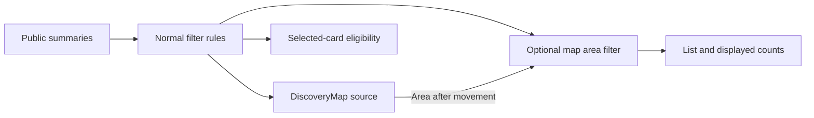

# Design

## TL;DR

- `Discovery` keeps normal filter results for the map and selected card checks.
  A second list applies a runtime map area while `Follow map` is active.
- The map keeps its existing camera callback. A separate area callback updates
  the list after user movement. Layout changes and selection pans keep the area.
- The visit snapshot adds only the follow setting. A restored camera supplies a
  new area. An empty area uses the same switch to return to all filter results.

See the [proposal](proposal.md) for the requested result and acceptance criteria.

## Contracts

Proposed additions to the pure discovery model:

```ts
export type MapArea = {
  west: number;
  south: number;
  east: number;
  north: number;
};

export function filterMapArea(
  summaries: DiscoverySummary[],
  area: MapArea,
): DiscoverySummary[];
```

Use an unwrapped longitude interval with `east >= west`. Keep latitude bounds
inclusive. Match an equivalent longitude copy inside the interval. An interval
of at least 360 degrees accepts every longitude. Each summary remains one row.
The helper preserves input order and excludes summaries without coordinates.

Keep the map adapter's existing `onCameraChange` callback. Proposed additions to
its [props](../../../../src/features/discovery/map/discovery-map.tsx):

```ts
followMap: boolean;
onAreaChange: (area: MapArea | null) => void;
```

An area report replaces the runtime search area. `null` means that the map is
unavailable and suspends the area constraint. The existing camera callback keeps
its current role, including saving camera changes caused by layout or selection.
The adapter reads its current bounds when follow mode turns on.

Extend [DiscoveryVisit](../../../../src/site/discovery-context.ts) with the proposed
field below:

```ts
followMap: boolean;
```

The snapshot reader defaults a missing flag to `true`. It rejects a present
nonboolean flag through the existing invalid-snapshot path. Keep the current
camera validation. Map bounds remain runtime state and need no storage validation.

## Architecture



[Discovery](../../../../src/features/discovery/discovery.tsx) owns the switch and one
runtime search area. A null area also identifies an unavailable map. Discovery
passes the full normal result set to the map. It uses that same set to decide
whether a selected card is still eligible. It passes only the area result set to
`ResultsList`.

Apply the same effective area to the pending filter count, so the Apply button
predicts the resulting list. Keep country and genre choices based on the catalog.
The map adapter owns Mapbox calls and movement causes. Keep the filter helper
free of Mapbox, React, and storage code. No new controller or server path is needed.

## Key decisions

### Area and movement

Use `Map.getBounds()` for the geographic rectangle of the full map canvas.
Panels do not remove parts of that rectangle. This avoids changes caused only by
an overlay opening. At a rotated or tilted view, the rectangle can include points
outside the drawn polygon. Exact pixel visibility is outside this change.
Clustering affects map drawing only. Do not use rendered marker IDs as inventory.

Mapbox already supplies bounds and movement events. Its
[map API](https://docs.mapbox.com/mapbox-gl-js/api/map/) and installed type
definitions support event data on camera calls. Tag only zoom-control and
cluster-expansion calls as area changes. Untagged programmatic camera changes
leave the search area unchanged. Do not add a timer or a second camera event system.

Report the area on `moveend` for direct gestures with `originalEvent` and for
tagged camera calls. Exclude browser resize, orientation, and fullscreen events:
Mapbox also attaches `originalEvent` to automatic resize movement. Publish the
initial area after fit. After a visit's camera is restored, publish a fresh area
from that view. Report an initial area even if no located result can be fitted.
Selection pans, explicit resize calls, and restore calls need no new tags.

Turning follow mode on publishes the current bounds, including changes caused by
layout while follow was off. The parent needs no separate copy of live bounds.
Map errors and missing configuration report a null area. The switch is disabled
until the map is usable. Its saved preference is retained. Normal filter edits
keep the current search area and camera.

### Results and controls

Use a native checkbox with the visible label `Follow map` in the results heading.
Give it enough space on a separate mobile heading row and retain a clear focus
style. Its accessible help text explains that it limits the list to the map area.

With an active area, qualify the heading and status with `in map area`. The switch
help text explains that turning follow off includes events without map locations.
No separate count of hidden unlocated events is needed. With no active area,
retain the existing count meaning.

An empty area uses `No events in this map area`. It tells users to move the map
or turn `Follow map` off with the heading switch. Use that same switch as the
recovery control. A normal filter result of zero keeps the existing message and
reset action. Clear all filters keeps the follow setting.

Keep the current list scroll behavior and saved scroll restoration. Keep an open
card when only its list row leaves the area; normal filters still control card
eligibility.

### Visit state

Reuse the current session-storage snapshot and history token. Save the follow
setting with the existing camera, selection, and scroll. On return, derive the
search area from the restored map. Layout changes or a previous selection pan can
produce a different list. This accepted trade-off removes separate area storage,
bounds validation, and exact area restoration. Keep the runtime area stable while
the mobile list expands or a card opens during the current visit.

Filter and mobile view changes keep the follow setting. The switch does not add
a history entry. Map movement adds no URL parameters or history entries. Shared
filter URLs start with follow mode on and derive their area from the initial fit.

## Risks and validation

- A list subset passed back to the map would hide inventory in other areas.
  A focused Discovery test must check the map props after an area change.
- Resize and selection pans also emit movement events. Check adapter event
  handling and use the built-in Browser to verify mobile expansion and card
  opening keep the list unchanged. Include a real zoom and cluster expansion.
- A selected row can disappear while its card remains valid. Extend the existing
  selection journey to check this case. Existing real-map tests that require an
  off-area or unlocated row must turn follow off before selecting that row.
- Longitude copies can remove valid date-line events or duplicate rows. Test the
  helper with crossing and shifted bounds, full-world coverage, and null points.
- Old or unavailable visit storage must leave discovery usable. Extend the
  existing snapshot tests for the flag default and invalid values. Check that
  navigation restores the flag and derives an area after camera restoration.
- Update the Discovery paragraph in the project structure guide with the new
  data flow. Run focused tests, type checking, lint, documentation checks, and
  OpenSpec validation. Use the built-in Browser for local UI checks.
