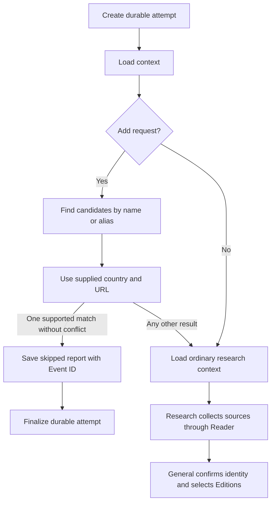

# Design

## TL;DR

- Find local candidates by complete Event name or alias at the start of `load-context` for add.
- Use country and URL only when supplied. One name-and-country match or one name-and-official-URL match can end the attempt as `skipped` before source or model calls. Conflicts and unresolved matches continue ordinary research.
- Save the matched name and supporting country or URL in an optional report field. Keep model responses empty.
- This rule trusts the note and catalog. It saves repeat work but does not solve General context growth for new Events.

See the [proposal](proposal.md) for the changed behavior and acceptance criteria.

## Contracts

Proposed addition to [ResearchContext](../../../../src/ingestion/research/context.ts) and [CatalogResearchResult](../../../../src/ingestion/contracts.ts):

```typescript
type InputDuplicateMatch = {
  eventId: string;
  matchedName: string;
  support: { countryCode: string } | { officialUrl: string };
};

// Optional field in both existing contracts:
// inputDuplicate?: InputDuplicateMatch;
```

The context field records the local match. The report field is present only for an early skip that completed without errors. Absence does not establish that research ran; old reports can also omit it. Ordinary General duplicate decisions keep their current output.

Keep report version 7. This addition is optional and does not change existing fields or enums. [Run finalization](../../../../src/ingestion/runs.ts) accepts version 7, and the catalog query tool reads report JSON through SQL. Existing saved reports need no conversion.

For an early skip, report construction sets `researchStatus: "success"`. Here, success means the add request completed under the early-match rule. It does not claim that sources were read. The new field makes that basis explicit. Research, General, Editor, and Location remain `not_run`, with null model responses. Source lists, operations, receipts, and changes are empty. Page, search, and model-call counters are zero.

Apply this success rule only to an add with outcome `skipped`, a local match, and no errors. Keep the current failure path for report, workflow, and persistence errors. A stored match cannot turn a failed attempt into success.

## Architecture



Put the private database reads in `catalog/read` and the matching rule in `ingestion/research`. Extend [loadResearchContext](../../../../src/ingestion/research/context.ts) to run the check before `readResearchCatalog` or taxonomy reads. On a match, return the fixed run date, empty catalog/terms/knownLinks, and `inputDuplicate`. The check reads distinct country codes from saved Editions, but does not load full Edition history.

In the existing [load-context phase](../../../../src/ingestion/workflow.ts), copy the matched Event ID into skip diagnostics, set the outcome, and build the report. Mark source identity validation as `not_run`. Reuse the existing terminal-report guards and finalization. Do not create synthetic General output or source evidence. CLI, Studio, and queued jobs already use this workflow.

## Key decisions

### Start with the name or alias

The input stays one complete free-text note. It needs no fixed line format or new fields. Find every Event whose complete canonical name or alias occurs outside URL tokens. Normalize Unicode to NFC, convert case with `toLowerCase()`, trim, and collapse whitespace. Use Unicode letter, mark, and number boundaries. Do not remove accents, translate, infer aliases, or use fuzzy similarity. A URL slug alone cannot supply the name.

Keep distinct Event IDs. Repeated names, aliases, or links for one Event do not create several candidates. An Event without saved official links can still match by name and country.

### Use country when it is clear

The first version recognizes an assigned two-letter country code as a complete comma-, semicolon-, or line-separated field, or after a `country:` label. Case does not matter. Thus `example fest, us` supplies `US`. Exclude matched name spans and URL tokens from this parsing. Reuse [isAssignedCountryCode](../../../../src/catalog/domain/country-codes.ts); add no second country list. Other country wording stays in the note for ordinary research. Do not infer a country from a hostname, map pin, or model call. Several distinct explicit country codes make the early check unresolved.

The catalog stores country on [Editions](../../../../src/db/schema.ts), not on the Event. Read the distinct non-null country codes for each name candidate. No codes means unknown. One code can support the country match. Several codes make that candidate unresolved for an early skip.

With a clear request country, remove candidates whose sole known country differs. Keep candidates with unknown or conflicting saved countries. Missing country is not a mismatch. An exact official URL can still resolve a candidate with unknown country. It cannot override a known country conflict.

### Use URL as an optional extra signal

Recognize complete HTTP/S URL tokens in plain text, Markdown links, and angle brackets. Ignore a token if it cannot be parsed without guessing. Compare parsed full URLs using the standard URL representation. Keep scheme, path, query, and fragment. Do not equate `www` hosts, remove parameters, follow redirects, or accept a saved URL as a prefix of a longer URL.

Use saved Event links with `official: true`, including websites and social links. Exclude Edition links and unofficial links. A URL cannot introduce an Event whose name or alias did not match. If a supplied URL has exact catalog matches but none are among the remaining name candidates, the signals conflict. Continue ordinary research. This includes a URL that identifies only a candidate excluded by the request country.

A different path does not veto a name-and-country match. For example, a saved `/` and supplied `/en/index` can still lead to a country-supported skip. A shared hostname alone cannot confirm identity or resolve several candidates. A URL with no exact catalog match is inconclusive; it is not proof of a different Event.

### Make one deterministic decision

After the country comparison, use these rules in order:

1. An explicit conflict between the supplied signals, or several explicit request countries, continues ordinary research.
2. Exact official URL matches can resolve the remaining name candidates. One distinct Event with no saved country conflict can return early `skipped`, including when country is unknown. Several URL-supported Events continue ordinary research.
3. Without an exact URL match, skip only if one name candidate remains and its sole saved country matches the request country. An additional candidate with unknown country keeps this case unresolved.
4. All other results continue ordinary research. A unique name alone is insufficient.

Record the full official URL as `support` when rule 2 applies. Otherwise record the matched country from rule 3. No score, model, or arbitrary candidate cutoff is needed. Keep the original note unchanged.

This rule checks literal mentions. It does not understand negation, comparisons, or a wrong association in a note. Incorrect input, or two different Events with the same name and country, can cause a wrong skip. This trust change is part of the requested shortcut. A source-confirmed early check would need a source read and a separate identity decision before full collection.

### Keep the check local and narrow

Read Event IDs, names, and aliases for local matching. Then read only distinct saved country codes for the name candidates. When URLs are supplied, read the official Event link data needed for comparison and conflict detection. Do not make saved links a requirement for candidate lookup.

A narrow local scan is sufficient for the current hundreds or thousands of Events. Do not load full Editions, add a search service, or send the catalog to a model for this check. Apply the rule to all matching rows; do not take the first match or impose a candidate limit.

The current `readResearchCatalog` loads full Events and Editions. Reusing it would add work that the early path does not need. Reusing the General duplicate validator would require source evidence that this path does not collect.

A required full URL would be simpler to compare, but would miss requests without links and requests that use another page of the same site. The country branch covers those cases. A name-only or hostname-only skip would remove a check against different Events with the same name or organizer. Fresh source confirmation would retain the current evidence contract, but would need source reads and changes to the evidence lifecycle.

### Preserve the ordinary research path

No early match means only that the shortcut did not apply. Load the same context and use the same collection and General decisions as today. In particular, a failed lookup does not authorize creation. Refresh does not use this check.

Requests for new Events still load the full catalog for General and can exceed its context limit. That input needs a separate change. Keeping that work separate avoids candidate-recall rules and new Reader output in this proposal.

### Update report consumers

The [catalog-sql skill](../../../../src/mastra/catalog-assistant/skills/catalog-sql/SKILL.md) currently recognizes a duplicate only through General output. Its [add-batch query](../../../../src/mastra/catalog-assistant/skills/catalog-sql/references/inspect-add-batch.sql) exposes the identity decision from `modelResponse`. An early skip has no such response.

Expose `inputDuplicate` separately in that query. Update the skill to distinguish country-supported and URL-supported note/catalog skips from a duplicate confirmed by inspected sources. Require outcome `skipped` and agreement between the report Event ID and the match Event ID for the early label. Keep unknown and failed attempts distinct. Cover both support forms and the current source-confirmed path in the existing query tests.

Update the `add_events` description and catalog assistant instructions where they describe all add text as search leads or explain saved results. The shortcut is an exception for skipping only. New catalog facts still require source evidence.

## Risks and validation

- Wrong skips: test both support branches, name-only input, name fragments, URL-only input, shared hosts, URL prefixes, and explicit name/country/URL conflicts. Include several same-name candidates, an unknown-country competitor, and conflicting saved countries. Tests can verify the rule, but cannot prove the note or saved facts are true.
- Country parsing: test `example fest, us`, a labeled code, code text inside a name or URL, unsupported wording, and several explicit countries. Verify that only recognized input supplies country support and that collection receives the unchanged note on fallback.
- Accidental source work: use workflow spies for page reads, search, Reader, all model roles, and the writer. Test both preview and apply. A matched add calls none of them.
- False failure reports: verify a matched add finalizes as `completed`, retains the matched Event ID in both the report and run row, and passes the existing CLI and job success checks. Cover report construction and persistence failures through the existing failure path.
- Unneeded reads: use a small identity fixture and verify a matched add does not call `readResearchCatalog` or load full Edition history or taxonomy. A name-and-country match without a URL needs no official link. These assertions check the early path without a large test fixture or a timing benchmark.
- Compatibility: keep ordinary duplicate, long-note, and refresh tests. Read a version 7 report without the optional field. Update the ingestion guides to explain the new exception to the search-leads rule.

All planned verification uses local test data and fake source/model dependencies. Paid ingestion evals are not needed for this deterministic rule.
