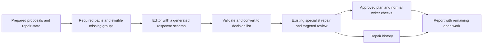

# Design

## TL;DR

- **Review:** Give Editor required decisions by exact path. Put eligible missing groups in a separate list. The response schema requires all normal decisions and allows only a return request for a missing group.
- **Flow:** Validate the model reply, convert it to the existing decision list, and use the existing specialist repair loop. Specialists retain ownership of values and the three-return limit.
- **Completion:** Keep an approved withdrawal in repair history. Remove only its settled omission question from open work. Independent unfinished checks and source limitations still make research partial.
- **Evaluation:** Check the two changed Event descriptions against content requirements. In captured evals, check Editor completion and the existing case results. Workflow owns specialist return execution and write guards.

The behavior and scope are in [proposal.md](proposal.md). General repairs and source collection retain their current contracts.

## Current behavior and evidence

[reviewPaths](../../../../src/ingestion/roles/editor/review.ts) puts required decisions and absent optional groups in one list. An absent group allows only `return`. [reviewSchema](../../../../src/ingestion/roles/editor/validate.ts) checks path coverage and allowed decisions after generation. Its base response schema still permits any string path and any decision. The [model schema adapter](../../../../src/ingestion/runtime/model-output.ts) cannot convey those custom checks as response structure.

The [Editor prompt](../../../../src/ingestion/roles/editor/prompt.ts) already permits an approved withdrawal and forbids returns for an optional gap alone. It also accepts indirect source support in context. The proposal makes these rules easier to follow; it does not introduce a stricter evidence policy.

[ProposalRepairs](../../../../src/ingestion/repairs.ts) stores an exact-path omission reason in both repair history and the merged role's unresolved questions. [buildResearchReport](../../../../src/ingestion/report.ts) then treats that question as an unfinished role check before it considers a verified finding. The current [guide](../../../../docs/ingestion-process.md#accepting-research-values) explicitly says that withdrawal leaves the check open. This proposal changes that rule only for an approved withdrawal with no independent unfinished work.

[researchContext](../../../../src/ingestion/evals/research.ts) reads description proposals from the original Classification response. The [size-history checks](../../../../src/ingestion/evals/cases/size-history/checks.ts) compare catalog changes with those original texts. [scoreCase](../../../../src/ingestion/evals/score.ts) rejects every initial return in a captured handoff, although eligible Location execution remains live.

| Failure group from the investigation | Cases affected by this plan |
| --- | --- |
| Invalid Editor decisions | `scope-current-ongoing`, `scope-current-stable-key`, `source-homonym-wrong-saved-website`, `search-unknown-official` |
| Return without a concrete missing fact | `source-stale-language-other-programme` |
| Approved omission reported as open work | `narrow-current-stable`, `search-date-conflict`, `search-withheld-place` |
| Source context or eval interpretation | `size-historical-and-unknown`, `editor-valid-update` |

Some cases have more than one cause. In particular, the size case also had a collection blocker. This plan does not suppress that blocker or promise that every listed case will pass. The previous outputs identify failure paths; fresh runs on the implementation revision must establish the result.

## Contracts

Keep the existing [ReviewDecision and ReviewDecisions](../../../../src/ingestion/roles/editor/contracts.ts) as the workflow and report contract. Change only the model-facing Editor reply and its input grouping.

Proposed model input and reply, shown for one review:

```typescript
// Proposed input. Entries come from the existing review-path calculation.
{
  reviewPaths: [
    { path: "item", allowed: ["approve", "reject"] },
    { path: "event.target", allowed: ["approve", "reject"] },
    { path: "currentOrNextEdition.target", allowed: ["approve", "reject"] },
    { path: "currentOrNextEdition.fields.tickets", allowed: ["approve", "return"] }
  ],
  missingGroups: ["currentOrNextEdition.fields.links.tickets"]
}

// Proposed reply. The schema defines these exact keys and their decision enums.
{
  decisions: {
    item: { decision: "approve", note: "The source confirms identity." },
    "event.target": { decision: "approve", note: "The country matches." },
    "currentOrNextEdition.target": {
      decision: "approve", note: "The selected Edition is correct."
    },
    "currentOrNextEdition.fields.tickets": {
      decision: "approve", note: "The source supports these offers."
    }
  },
  missingReturns: [
    {
      path: "currentOrNextEdition.fields.links.tickets",
      note: "Use the exact current ticket URL shown in the saved passage."
    }
  ]
}
```

Every key in `decisions` is required. Each value permits only that path's allowed decisions and a nonblank note. The schema rejects unknown keys. The `missingReturns` path enum contains only eligible absent groups, with no approval or rejection action. An empty list requests no missing facts. Omit that response property when no eligible missing group exists; the generated schema then has no such property.

A group becomes a required decision after a return, including a valid explained withdrawal. Targeted review contains only those returned groups. It introduces no new missing-group requests.

The Editor boundary converts a valid keyed reply into the existing flat list. Each missing request becomes a normal `return` decision. Convert successful `output` and `modelResponse.object` at that boundary so workflow, report, CLI, and existing decision consumers keep the same shape. Retain the returned text for diagnosis. An invalid raw reply remains available for diagnosis as it is today.

## Architecture



[runEditor](../../../../src/ingestion/roles/editor/agent.ts) owns the model contract and conversion. The existing [workflow](../../../../src/ingestion/workflow.ts) owns review merging, specialist returns, and final filtering. [ProposalRepairs](../../../../src/ingestion/repairs.ts) continues to validate and merge specialist revisions. Editor supplies no replacement values. Reporting decides which questions remain open; it does not change review decisions or writes.

## Key decisions

### Use the response shape to require decisions

A shorter prompt alone is the smallest change, but the present prompt already states the rules that failed. Retaining a free-path array would still leave missing required paths and invalid actions to post-generation checks. Use the existing generated object-schema support to express required keys and per-path enums. Add no output repair framework or model pass beyond the existing correction attempt.

Reuse the existing review-path calculation for assignment, return availability, and limits. Split its result at the Editor boundary. Do not maintain a second path registry. Keep local validation for nonblank notes and duplicate missing requests. Reject an invalid complete reply after the existing single correction attempt; do not silently discard invalid entries or invent approvals.

Removing omission review would be simpler, but it would lose the existing correction of a concrete missing ticket offer or exact URL. A separate return-request list preserves that behavior without presenting an omission as an ordinary approval choice.

### Shorten the decision process without losing field rules

Put the prompt in a clear order: required decisions, concrete missing facts, evidence use, then field rules. State return and withdrawal rules once. Reuse the existing shared date, status, description, and classification rules. Preserve distinct ticket, link, identity, and place safeguards; remove only repeated instructions.

Require a material disputed claim or a concrete supported missing fact for a return. A note names the claim, relevant evidence or saved passage, and the supported correction or withdrawal. An unknown optional size, display name, URL, or coordinate alone needs no return.

Judge the meaning of the whole relevant passage. A regular programme can support recurring description features. Text that clearly identifies the festival site and then gives its address can support that address without repeating a venue label. Keep the checks that distinguish an organiser office, unrelated programme, wrong Edition, or invented experience. Keep the current saved-page search conditions and bounded tools; do not require a new search for each fact.

### Settle only the approved omission question

Use the latest repair record for each exact path. A settled withdrawal has a valid omission reason, no remaining revision or local failure, and a final `approve` decision. This information already exists in repair history; add no parallel completion state.

During report construction, match the full path and trimmed omission reason within this run. The path identifies the fixed Event or Edition slot. A question's `editionKey` is optional; if present, it must match the repair target. An absent key needs no target reconstruction. Remove only that settled question from open work and keep the reason in `repairs`. A different question for the same path or an explicitly different Edition stays open. Earlier repair attempts do not settle a later failed or unreviewed attempt.

Then run the existing assigned-check logic. A verified finding can finish when no independent question remains. An `unfinished` finding, missing assigned finding, collection blocker, limited source, or final failed group still makes research incomplete. Do not change catalog outcome rules or convert partial results to success as a general fallback.

### Fix eval interpretation using existing report data

Keep the original Classification response for proposal diagnostics. In `size-history/checks.ts`, read the target Event's two changed values once from `report.changes`. Match the Event ID and the `description` and `short_description` fields, as the existing [catalogChanges](../../../../src/ingestion/evals/changes.ts) selector does. Apply the content checks to those `newValue` strings. Both cases already require both descriptions to change. A missing, null, or empty changed value fails that requirement; saved text alone does not satisfy it.

Use the same two values for the shared description checks and the announced-move check. This removes operation extraction and a separate comparison between the plan and catalog changes. Do not reconstruct text from raw replies or repair history. Keep focused workflow coverage that only an approved revision is saved and that rejected or withdrawn values do not reappear. The scenario scorer checks the actual changed content without repeating that boundary check. Main eval already assesses the resulting catalog descriptions; keep that behavior.

Replace the blanket captured-handoff return failure with checks of Editor completion and the existing case results. Require a valid normalized Editor reply and successful completion, except in cases that expect to stop before Editor. Keep the case outcome and final catalog checks. A repair failure can leave the initial Editor status successful; the case outcome checks must still fail that run. A captured case that intentionally stops before Editor, such as unavailable sources, keeps its existing refusal checks.

The existing [workflow](../../../../src/ingestion/workflow.ts) selects applicable returns, runs specialist repairs and targeted review, and prevents writes on failure. Keep return execution, cancellation after target rejection, live conversation enforcement, and failure write guards in focused runtime checks. The scorer checks the completed result without reconstructing assigned groups, merged review decisions, or required repair records. A cancelled return alone adds no eval failure.

This choice removes a separate report consistency check: a report that claims success but omits a required repair record does not fail solely for that omission. Workflow and its tests own the return execution guarantee.

Captured role data and report fields retain schema version 7. The changed Editor model contract needs a prompt-version update and updates to controlled Editor generators. It needs no catalog migration or rewrite of historical reports.

## Risks and validation

- **Lost omission correction:** Keep a workflow check where source evidence supplies a concrete missing ticket URL or offer. A missing optional value without that evidence must request no return.
- **Invalid complete replies:** Check the generated schema and the invocation correction path. Missing required keys, forbidden actions, unknown paths, duplicate missing requests, and a second invalid reply must not lead to writes.
- **False success:** Compare an approved withdrawal on a complete check with the same withdrawal beside an unfinished check, collection blocker, or limited source. Cover a question without `editionKey`, an explicitly different Edition, a final rejected group, and a recovered earlier failure.
- **Weaker evidence review:** Use paired source examples for a contextual festival address and organiser office, and for a regular feature and invented promise. Keep existing wrong-year, qualification, payment-plan, and dependent-change checks.
- **False eval result:** Check final description content and actual changes, including missing text and unsupported text. In workflow checks, verify that the approved revision replaces its original and that rejected or withdrawn text cannot reappear. For captured evals, check successful live Location continuation, a cancelled return with no repair record, an invalid or failed Editor reply, a failed repair after a successful initial Editor reply, and an expected stop before Editor. Keep return execution and write guards in runtime checks.

Run focused deterministic checks first. Then run the affected pipeline cases and the complete Editor eval group through Codex in parallel, with separate databases and fixed model settings. Keep all existing case expectations unless this plan identifies the scorer defect. Check related previously passing cases as well as the failed cases. Record the code revision, fixture/scorer revision, settings, and remaining causes. A newly exposed General or collection failure remains a separate result.

## Follow-up experiments

Use the implemented plan as the baseline. Compare a rule that allows returns for absent ticket offers and ticket links only. Require a passage that supports a specific fact for the selected Edition. Specialists continue to check completeness. Editor still reviews every submitted group and any revision.

In the saved runs, returns for absent display names and size estimates added no facts in `search-date-conflict` and `search-withheld-place`. In `source-known-offers-blocked-checkout`, Links supplied a missing official checkout URL after an Editor return, and the catalog saved it. Include both types of case. Keep the checkout link absent at handoff and let Links revise. Compare supported facts saved or lost, unsupported changes accepted, unnecessary returns, open checks, and model calls. Use the same evidence, live roles, model settings, and scorer for both variants.

Two other variants can test the limits of the review. A review of submitted proposals only would remove all returns for absent groups. It would lose the checkout recovery unless Links finds the URL on its first pass. A separate review of targets before fields could stop sooner on a wrong target and give field review less context. It would add a sequential model call on valid items. The saved failures give little reason to test the second variant first.
