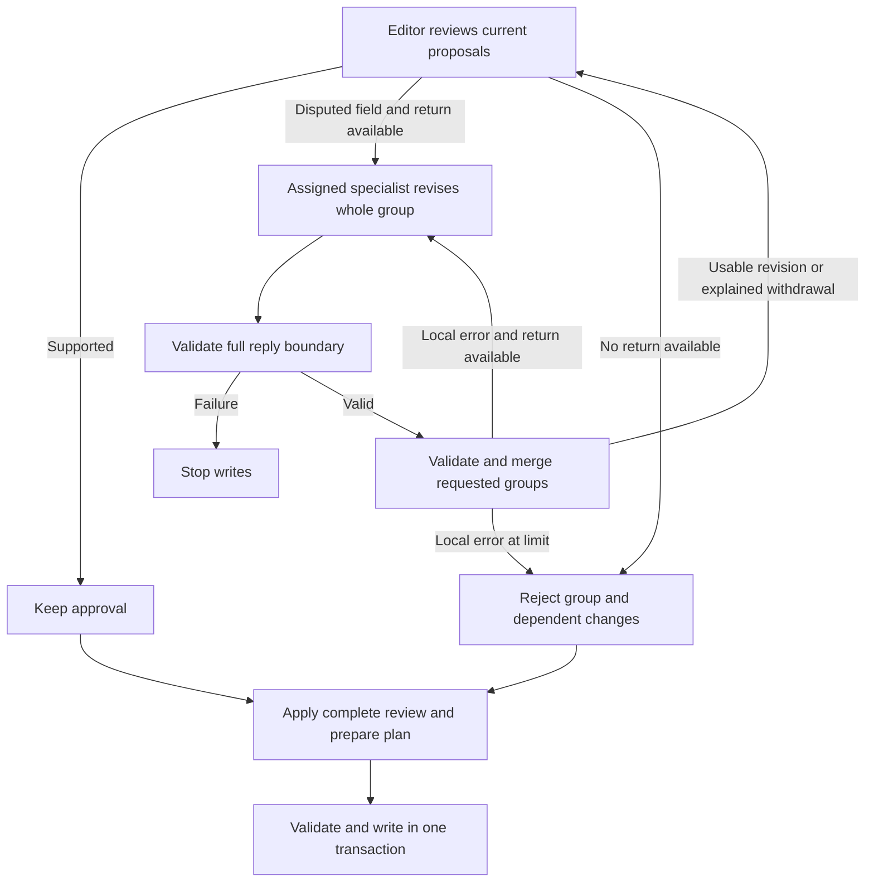

# Design

## TL;DR

- **Review:** Editor accepts a supported field proposal or returns it to its owner while a return is available. The owner can correct the whole group or withdraw it with an exact-path reason.
- **Repair:** Validate the full reply boundary, then handle requested groups separately. Keep valid revisions. Return local errors within the existing three-return limit. Reject only an unresolved group and its dependent changes.
- **Write:** Editor reviews every usable revision. Reuse `applyReview` to remove rejected changes. Apply the remaining plan in the existing single transaction.
- **Safety:** Identity, country, fixed targets, references, complete Editor output, deadlines, publication, and writer checks retain their current authority. A boundary failure still stops writes.

The [proposal](proposal.md) defines the required results. This design changes the review and repair flow without a new model reply format, catalog operation, or persisted status.

## Contracts

[ReviewPath](../../../src/ingestion/roles/editor/contracts.ts) and the model decision shape stay in use. Code changes the allowed decisions for field groups:

```ts
// Proposed policy for a required field group.
const allowed = canReturnGroup
  ? ["approve", "return"]
  : ["approve", "reject"];
```

`canReturnGroup` uses the existing live conversation and shared per-path count. Item and target paths retain `approve` and `reject`. An absent optional group is still optional and permits only `return`. A previously returned omission can be approved after its exact-path reason passes validation.

Keep the existing `SpecialistOutputs` result from [ProposalRepairs](../../../src/ingestion/repairs.ts). Store a final code rejection in the affected group's latest `RepairRecord.decision`. Keep its diagnostic in `failure`. The workflow reads these existing records instead of receiving a separate rejection list.

Use existing `GroupIssue`, `RepairRecord`, and `ReviewDecision` data. Use `GroupIssue` for each local error, including a missing exact-path omission reason. Move that check from the throwing merge step into scoped group validation. A diagnostic field or message alone does not establish that an error is local. Unmapped errors remain fatal.

Each requested group has a final result before this call returns. Read the latest record for each path to find final code rejections. An earlier failed attempt that later recovers is history, not a final rejection. The caller derives usable revisions from the requested groups minus final rejections. Keep the existing assignment order.

Keep [CatalogResearchResult](../../../src/ingestion/contracts.ts) at its current shape. Existing repair records hold attempts, local failures, omission reasons, and final decisions. Existing unresolved items and research status describe unfinished work. No historical report or catalog migration is needed.

## Architecture

The current [review loop](../../../src/ingestion/workflow.ts), [group validators](../../../src/ingestion/roles/proposal-validation.ts), and [applyReview](../../../src/ingestion/proposals.ts) already own most of the required behavior. Change their control flow at the points where a field rejection or repair exception currently ends useful work.



The diagram follows one group. Other groups retain their own results. The workflow prepares a catalog plan only after all requested groups have a final result. It does not write between repairs.

### Review routing

Change [reviewPaths](../../../src/ingestion/roles/editor/review.ts) and [Editor instructions](../../../src/ingestion/roles/editor/prompt.ts) together. A submitted field proposal can be repaired by changing its value or withdrawing it. While its owner and allowance are available, Editor uses `approve` or `return`. Code exposes `reject` when a return is unavailable or the limit is reached.

Editor compares `prepared.plan` with saved state. Saved state is context, not a second proposal to repair. An already correct current proposal needs no return. An absent optional social value is not an error. Editor returns an omission only for a concrete supported correction that the field can represent.

A return note names the disputed claim and the supported correction. It can ask the specialist to remove an unsupported part while retaining supported parts of the group. If no supported replacement is available, the note asks the owner to withdraw the proposal. Editor never writes the replacement itself. Update contradictory instructions that currently permit an immediate field rejection.

A valid withdrawal can end review early. Editor approves the absence of a new proposal, not the truth of the saved value. Keep applicable questions open. Do not force the specialist to use every remaining return after the issue is settled.

### Scoped repair handling

Keep one request per owner in a round. Within that request, track each group separately:

1. Check the whole raw revision for identity, fixed targets, country, assignment, and known evidence, source, and point references. Run these checks before removing or ignoring any field.
2. Collect local issues for requested groups through `GroupIssue`. Check omission reasons against the exact requested path before merge. Do not infer or rewrite a reason from a short field name.
3. Merge each valid requested group and its questions into a candidate reply. Preserve unrequested values from the validated reply. Never take unrelated changes from the revision.
4. Keep a failed group out of usable output. Use its role's existing no-proposal form. For Location, use existing keep actions for the whole bundle and preserve its accepted slot. This does not approve the disputed original proposal.
5. Validate the complete combined reply and fixed targets again. A remaining error can be local only if the existing validator maps it to an assigned group. An unmapped error stops writes.
6. Return only failed groups with their validator feedback while their shared allowance remains. Retain valid peer revisions without resending them. At the limit, record a final code rejection for the failed group.
7. Continue with other owners after local failures. A fatal error still propagates. Record a local failure only on its affected group, not on every group in the owner batch.

Apply the same local handling to a validation-triggered return before Editor and to an Editor-triggered return. Initial General validation still has to establish valid identity and targets. It cannot drop a temporal target error to create a valid assignment.

The existing maximum is three specialist returns per path. Validation, semantic review, and local reply corrections share that count. Do not add a separate format retry counter, increase the run deadline, or add specialist tools. A valid reply from the last return still goes to Editor. Editor can approve it. An invalid local reply at that limit receives a code rejection without another call.

### Final review and dependencies

Seed final code rejections from the latest repair records into the review map. Do this before the first Editor review and after each later repair call. Exclude those groups from further model review. Send all usable revisions, including explained withdrawals, to Editor. In the first review, include usable validation repairs. In later rounds, review only revised groups. Merge these decisions with earlier independent approvals. Keep code rejections in the map when final decisions are copied to the repair records.

Only final group decisions reach [applyReview](../../../src/ingestion/proposals.ts). A returned group that later fails cannot fall back to its original disputed value. Reuse existing removal rules: optional field rejection preserves saved data, temporal rejection removes its Edition, and rejected reuse premises remove their dependent changes. Keep whole classification, ticket, date, and Location groups indivisible.

Prepare operations once from the remaining accepted plan. Keep existing publication rules, donor version checks, baseline checks, and [applyCatalogItem](../../../src/catalog/write/apply-operation.ts). A database error rolls back the whole transaction. Independent validation does not mean separate commits.

## Key decisions

**Use the existing groups and return budget.** The request needs earlier specialist correction and local failure handling. Prompt changes alone cannot keep a ticket correction after a peer omission error throws. Changing only exception handling still leaves repairable classifications rejected before a return. The proposed flow reuses both existing mechanisms instead of adding another repair pipeline.

**Let the specialist withdraw a proposal.** This gives an unsupported field a safe result even when no replacement exists. It also avoids repeated returns for an issue that cannot be resolved from the available evidence. The trade-off is an extra specialist call for a disputed submitted field that Editor could previously reject immediately. Missing optional values do not trigger this call by themselves.

**Keep local errors separate from boundary failures.** Existing validators already map many field errors to `GroupIssue`. Retain that source of scope. Do not catch every `RepairFailure` and convert it to a group rejection. That simpler catch would hide target and reference failures.

**Keep accepted bundles intact.** Automatically extracting supported terms from a rejected classification would bypass its owner and Editor. The specialist supplies a new whole classification. The same rule applies to tickets, dates, and Location bundles.

**Keep value meaning unchanged.** An omitted proposal preserves the saved value. Classification `null` still keeps saved facet terms; an empty list still clears a list facet. This proposal does not solve the Turku case that needs an explicit single-facet clear and a publication decision. Withdrawing a date proposal also preserves saved dates; it does not clear them.

**Reuse reports and lifecycle states.** A locally dropped group leaves an unresolved item with its exact path and final reason. This makes research partial even when its original check said verified. A recovered earlier failure remains in repair history but does not alone make research partial. Keep the actual catalog outcome and normal completed lifecycle for a run that finishes with partial research. Fatal errors retain the failed lifecycle. No new partial outcome or report version is needed.

### Audit boundaries

The two audits cover different stages and dates. Their counts are not one failure total. Use their concrete behaviors as regression examples:

| Example | Expected result |
| --- | --- |
| Sundance, Copenhagen Jazz, Flow, and Pori Jazz | Return the disputed classification before its first field rejection. A repair can still fail review; publication is not guaranteed. |
| Defected Malta | Let Classification remove the unsupported optional claim and keep supported required terms in a new reviewed bundle. |
| Polarjazz | Retain a valid ticket-link revision while social omissions receive local feedback or final rejection. |
| Pop-Kultur Berlin | A missing exact-path date omission reason is local. Other owners can continue. If dates are ultimately rejected, remove the dependent Edition changes. |
| Defqon.1 | Dropping a fixed target from General's revision remains a fatal boundary error. Do not silently restore or accept it. |

Invalid initial required output remains outside local recovery. This includes the final invalid complete Editor reply for Open Air Gampel, the unknown evidence reference for Kraina Mriy, and the missing accepted Location slot for Errichetta. Do not promise recovery for all six response failures from the later audit. Historical jobs are not rerun by this change.

## Risks and validation

- **A disputed original value survives a failed repair:** add workflow checks for both saved and new targets. Assert the final operations and persisted fields, not only the repair records.
- **One bad group discards a valid peer or another owner's work:** check mixed groups and owners in the repair unit tests. Use a workflow case with a valid ticket link and a missing social omission reason to check saved values. Add one integration check that a final code rejection reaches `applyReview` and removes dependent changes.
- **A broad catch hides a safety failure:** keep negative tests for changed fixed targets, unknown references, country conflicts, and cancellation. Include a valid peer group in the same reply and still expect no writes.
- **The last valid revision is rejected because its count reached three:** test acceptance at that boundary, shared validation and Editor counts, and exhaustion with repeated local errors. A settled withdrawal and an untouched optional omission also need checks against unnecessary calls.
- **Reports hide dropped work or mark a recovered issue as final failure:** add final per-path decisions, reasons, partial research, receipts, and lifecycle assertions to the mixed-success case. Add recovered-status assertions to the return-limit case. Keep these checks in the fixtures that already exercise the repair result.

Extend existing [repair unit tests](../../../src/ingestion/repairs.unit.test.ts), [repair workflow tests](../../../src/ingestion/repairs.test.ts), and [Editor tests](../../../src/ingestion/roles/editor/workflow.test.ts). Existing tests already cover ordinary valid repair, batch counts, and cancellation. Reuse [proposal dependency tests](../../../src/ingestion/proposals.test.ts) and the independent-change case in the repair workflow tests. Test the new connection from code rejection to `applyReview` without copying the dependency matrix. Reuse [workflow tests](../../../src/ingestion/workflow.test.ts) for general preview/apply agreement and catalog, audit, and receipt rollback. Add a preview check for the mixed repair path, not another general writer suite. Change expected routing where needed and add only missing failure cases. Use deterministic model replies and disposable catalog fixtures. Paid evals, production writes, and historical replays are not required for implementation validation.

Update the implemented rules in [the ingestion process guide](../../../docs/ingestion-process.md) and report inspection steps in [the tools guide](../../../docs/ingestion-tools.md) during implementation. No data migration or automatic recovery step is part of rollout.
