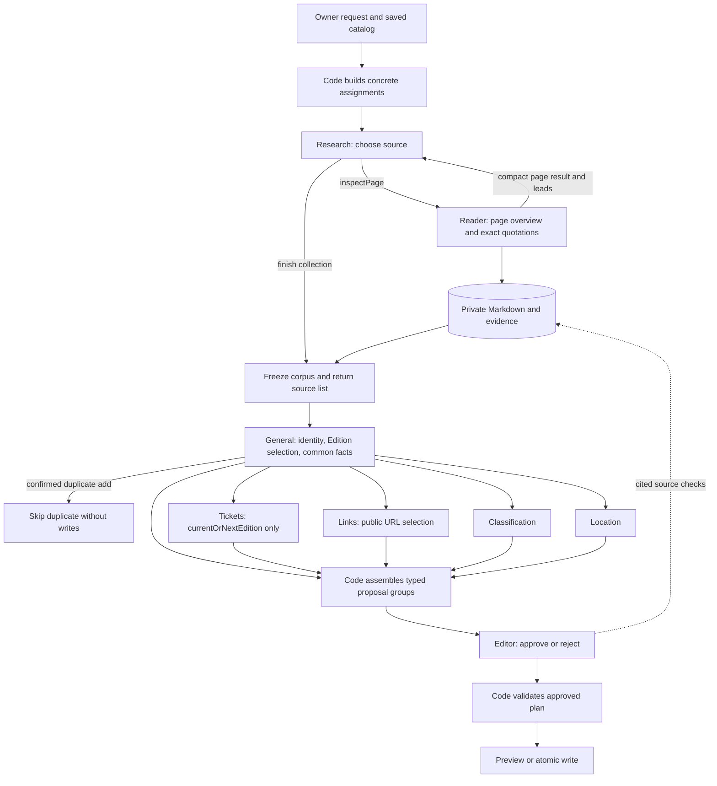

# Design

## Change size

Large. The change replaces the model contracts across collection, interpretation, review, reports, and evaluations. It adds private source artifacts and changes Location ordering. Catalog field types, write operations, and publication gates remain in use. The main uncertainty is extraction recall and total inference cost on large pages.

## Approach

Keep three product stages: collect evidence, propose changes, and review changes. Research selects pages. Reader receives one full parsed page per call, within a configured input limit, and saves quotations. Specialists use one fixed evidence corpus. Editor approves or rejects their proposals and reads source text only for validation.

The owner still starts `add`, `refresh/full`, or `refresh/current`. Code converts that input into concrete assignments. Tickets cover only `currentOrNextEdition`, including an ongoing Edition. Historical ticket prices, availability, offer URLs, and the Edition ticket link remain unchanged. See the [proposal](proposal.md) for scope and the [delta specs](specs/) for behavior.

This is a fixed workflow, not an agent network. It has eight model roles. Reader returns one structured result per page. General, Tickets, Classification, and Links each return one structured result when assigned. Only Research, Location geocoding, and Editor source checks need bounded iteration. No specialist starts another research round.

### Specification boundary

The specifications describe the complete ingestion result by domain. They define which facts can change, required support, preserved data, publication, errors, and owner inspection. Agent names, prompts, tool schemas, call order, and internal proposal types are design decisions in this document. A later internal refactor can change them while satisfying the same specifications.

Existing agent-specific requirements are rewritten as outcome requirements in this change. This is a one-time removal of implementation constraints, not a separate behavior change for each agent. Historical ticket exclusion, removal of per-offer URLs from ingestion, saved source artifacts, and removal of optional source-tool capture are the explicit scope and inspection changes. Existing temporal, classification, location, and write rules remain the baseline for the refactor.

## Architecture



Code selects evidence by the assigned topics and includes its inline context. Tags are nonexclusive; packets from the same frozen corpus may overlap. If a required packet exceeds its input bound, the stage reports a limit failure instead of silently dropping evidence. Code supplies relevant saved fields to each specialist; the arrows from General carry the fixed target context, not a new summary of the evidence. A confirmed duplicate add exits after General without specialists, Editor, or writes. Otherwise, Tickets, Classification, Location, and Links run in parallel after General. No branch consumes another branch's result. Code joins the results before Editor. Links can propose assigned public links even when Tickets is skipped or proposes no price block.

Every add uses the normal collection checks and stop rules before General compares Event identity with supplied catalog candidates. This keeps one collection path and removes the suspected-duplicate handoff. Actual duplicates can require additional source reads and Reader calls. Existing limits and partial-result rules still apply.

Use the installed Mastra workflow steps and parallel branches. Existing source access owns safe URLs, HTTP/Firecrawl retrieval, Markdown extraction, maps, caching, and cancellation. Existing catalog operations own versions, country checks, publication, and atomic writes. Application code adds assignment building, the corpus, exact reference binding, typed proposals, and review assembly. It does not add a scheduler, vector store, shell tool, or generic dependency engine.

Replace the old broad `ResearchCandidate` handoff and Editor `set`/`clear` output. Remove their duplicate domain instructions. Reuse field schemas, location point validation, taxonomy validation, money conversion, and catalog operations instead of keeping a compatibility path.

### Application module ownership

Two application modules own the handoff from specialist proposals to catalog operations. These are ordinary functions, with no new service layer. Paths below are under `src/ingestion/`.

| Owner | Input | Output and responsibility |
| --- | --- | --- |
| `proposals.ts`: `assembleProposals` | General and specialist domain results, assignment, frozen evidence, saved context, and registered points | `PreparedProposals`: fixed targets and proposal groups with their resolved support, owners, and versions. Validate ownership and references before Editor. |
| `proposals.ts`: `applyReview` | `PreparedProposals` and Editor decisions | `AcceptedProposals`: accepted targets and changes with their bound support and diagnostics. Validate decision keys and apply target and temporal prerequisites. Preserve rejected optional groups under the existing rules. |
| `catalog-plan.ts`: `prepareCatalogPlan` | `AcceptedProposals`, assignment, saved catalog, and vocabulary | `ReadyCatalogPlan`: catalog operations, explanations, and diagnostics. Reuse current money conversion, publication preparation, and operation validation. |

These application contracts do not inherit model execution records or the old `CheckedResearch` and `AcceptedEditorPlan` types. Keep actual model responses and technical execution data in the existing execution records. Reuse `StageResult` for continue, skip, and reject outcomes; a rejected item produces no ready operations.

Move the applicable operation-building code from `editor/prepare.ts` to `catalog-plan.ts`. The `editor/` module owns its prompt, decision schema, and model invocation. It does not own the combined proposal or catalog plan. Location keeps point validation in its existing module. `workflow.ts` coordinates these functions; the report projects their results and execution records. Neither application module calls a model, reads source files, or writes the database. The catalog writer keeps transaction ownership and version checks.

## Contracts

### Concrete assignments

Mode and scope remain host inputs and report fields. Research receives `instructions`, `checks`, `sourcePolicy`, `identityContext`, `knownLinks`, `currentDate`, and remaining limits. It does not receive `mode: add`, `scope: full`, or `scope: current`, and its prompt has no branches on those labels.

| Host request | Concrete collection and interpretation work |
| --- | --- |
| Add | Collect identity evidence, Event description/shared links, and evidence for the latest completed and current-or-next Editions under the normal stop and limit rules. Collect ticket evidence only for the latter. General compares the collected identity evidence with supplied catalog candidates after collection. |
| Full | Verify the targeted Event, description and shared links; inspect both Edition roles except historical ticket work. Allow source recovery under current discovery rules. |
| Current | Inspect the current-or-next announcement, dates, status, place, tickets, and classification. Do not audit Event fields or history. Do not recover the website. Report an identity contradiction and request a full refresh. |

The host also supplies matching instructions to General and field-specific assignments to specialists. Code enforces the original scope regardless of model instructions. History needed for identity, country, classification reuse, and earlier saved points is retained. Context overflow fails explicitly rather than dropping saved targets.

Example Research instruction: "Inspect the saved official site. Find the ongoing festival, or the nearest announced future festival if none is ongoing. Collect its programme dates, status, place, ticket offers, official ticket overview, and programme content. Do not investigate historical tickets or Event social accounts. Do not find a replacement website. Report relevant blocked checks."

### Source artifacts and evidence

Each run has a private artifact directory under the configured ingestion data root. It contains `sources/<sourceId>.md` and separate evidence files for each source. The root is resolved independently of process working directory and kept on persistent private storage for hosted runs. Files remain until explicit owner cleanup.

The collection step returns `sources[]` in its saved workflow result; no separate manifest file is written. Each entry retains source identity, retrieval outcome, coverage, and Markdown/evidence paths when available. Failed reads remain visible without invented artifact paths. Partial, failed, and cancelled collection results retain the available entries. Failure finalization must preserve this list in saved workflow results even when collection does not return normally. Downstream processing and inspection use these references. Deleting workflow history removes its source list but does not delete corpus files, catalog records, or reports; each Markdown file retains its own provenance.

Save the full parsed Markdown within existing retrieval bounds before model projection. Frontmatter separates application provenance from website metadata. Application fields include source ID, requested/final URL, retrieval time, method, status, limits, and a body hash. Website title, description, and date retain their source meaning. The body and website metadata view are immutable once stored; evidence offsets address this canonical text, not a later reformatting.

```text
CollectionResult: sources[], collection checks, stop reason, limits, questions
Source: id, URLs, retrieval metadata, Markdown/evidence paths,
        content hash, extraction coverage
Evidence: id, sourceId, exact quote, span, topics[], context[]
Inline context entry: exact quote, span in the same source
PageOverview: sourceId, content description, topics, stated years, coverage limits
LinkCandidate: sourceId, URL, label, evidenceIds[]
Lead: URL, label, purpose hint
```

The Reader response nests context quotes under each quotation and supplies no offsets or evidence IDs. Reader copies enough adjacent source text to make each quote and context quote unambiguous. A bare price or repeated label is insufficient when a longer literal passage can identify it. Reader does not paraphrase or join separate passages into one quote; separate headings, years, and qualifications belong in `context[]`. Code finds exact text in the canonical page input and assigns the evidence ID. Only a unique match becomes an anchored span. A missing or ambiguous quote or context match excludes that evidence item from usable support and retains a diagnostic; code does not silently correct it or assign the first match. Other valid evidence items remain usable. Relevant failed extraction checks remain unfinished. Use half-open UTF-16 offsets against the immutable JavaScript string; displayed line numbers are derived by code.

Evidence topics are nonexclusive hints. The same ID can support description, location, and ticket work. Prefer one coherent passage, such as a paragraph or small table, over separate quotations for each fact or price. Several facts can cite that passage without separate evidence IDs. Keep unrelated sections separate and avoid copying a large section merely to group facts. Each item contains its own headings, table headers, and qualifications in `context[]`, without separate context IDs or nested references. This removes context-reference resolution, but the same heading may be stored with several items. Evidence packets retain uncertain material relevant to the assignment and source metadata/body conflicts. Exact matching proves that text exists, not that its interpretation is correct.

Context quotes can come from distant parts of the same full-page input. Code binds each literal passage separately; distance does not require joining passages or creating another reference type. Reader must identify uncertain applicability when a year, table header, or qualification cannot be associated with the fact. A nearby heading or the page overview must not replace that missing basis. Uncertain material can remain in the corpus, but does not authorize a change without supported interpretation.

Each retained link candidate contains its URL, label, and source context. Two occurrences with the same URL can retain different contexts. Research follows URLs and Links selects public URLs directly. No cross-role link ID or offer-link decision map is needed.

Persist page extraction outcomes separately from retrieval outcomes. Reader receives the full canonical page and source metadata in one call, without chunks or a running overview. Code checks a configurable page-input limit before the call and reserves space for instructions and output within the selected model's context allowance. If the page does not fit, keep its full saved Markdown, record the processing limit, and mark the whole page as unprocessed without a Reader call or a truncated-prefix fallback. Its relevant checks remain unfinished. Other usable sources can still support a partial result under the existing failure policy. A successful fetch or completed Reader call does not prove complete factual checking. The returned bounded page overview is navigation context, never a sufficient basis for a catalog change.

Repeated inspection of a cached requested/final URL returns the saved result without another extraction pass. Targeted Editor checks may reread cited text. There is no repeated full-page scan, except the existing bounded recovery for explicit model-provider unavailability. All downstream roles use one frozen corpus. No corpus revision loop is introduced.

### Execution results and check outcomes

Code owns technical execution status, safe errors, and reasons for skipped calls. It records model and tool failures, invalid or missing required output, storage failures, cancellation, and reached limits from actual execution. Reuse the existing execution records and failure policy; do not add another status layer or a workflow state machine. Keep the actual model response when available, even if its structured output is invalid.

Models return only their typed domain result: proposals, identity and target decisions, review or place rejections, assigned check findings, and unresolved questions. They do not return a general execution `status`, technical `errors[]`, or workflow skip reasons. A domain discriminator such as `scheduleStatus` or a Location rejection remains part of the result. A valid domain rejection is a completed model call, but can still block writes or fail the item under the existing domain rules.

Check findings remain required where assigned. Research accounts for collection checks. General and specialists retain the source basis for verified unchanged values and identify unfinished mandatory work. Code combines these findings with the assignments, observed source outcomes, and processing coverage. A missing proposal or check finding does not certify verification. Successful model execution alone does not mean that research is complete. Missing optional facts alone do not make research partial.

Code decides which calls are required from the assignment and selected targets. When a role is skipped, code records its reason and makes no model call. A recoverable tool failure remains an observation and does not by itself invalidate a usable role result. A required failure without a valid result follows the existing whole-item failure policy. Source retrieval statuses and owner-facing domain outcomes remain separate from technical model execution.

### Proposals and final decisions

```text
TargetContext: identity decision, observedEventName and its basis,
               previousEdition, currentOrNextEdition,
               fixed date, saved versions, selection reasons and evidence
Change<T>: set value or permitted clear, reason, evidenceIds[]
Classification reuse: optional reuseFrom { editionKey, reason }
Role output: fixed domain fields and decisions, assigned check findings, unresolved[]
Execution record (code): technical outcome, validated output when available,
                         actual response, safe diagnostics, skip reason when applicable
Review: item decision, fixed target decisions,
        fixed field/group decisions, unresolved[]
```

Each role has a strict typed result. General owns `event.summary` and the common fields under `previousEdition` and `currentOrNextEdition`. Tickets owns only `currentOrNextEdition.tickets`. Classification and Location own their named groups under the two Edition slots. Links owns the permitted Event link fields and `currentOrNextEdition.links.tickets`. Roles cannot add other fields or select another target.

These are boundaries, not complete replacement schemas. Field values reuse the existing catalog types. The host binds each fixed slot to General's selected key and validates field ownership and support references. There is no generic `proposals[]` list, proposal ID, repeated target address, or `targetContextId`. A missing proposal preserves data without claiming verification. `clear` is allowed only for a clearable field and requires affirmative evidence. Unknown data belongs in unresolved questions. A null Edition slot means no selected target; `tickets.basePrice: null` remains a valid value inside a complete price block.

Code binds saved fields by their fixed slot and field name. It identifies retained classification terms by comparing the complete list with that target's saved assignments. Retained values and terms need no fresh quotation or extra model reference. Point actions identify their basis directly: `keep` uses the target point, `reusePrevious` uses the supplied `previousPoint`, and `select` uses its `pointId`. Code supplies the resolved values, owners, provenance, and applicable versions to Editor and the existing write validators.

When a classification proposal reuses terms from an earlier saved Edition, it includes `reuseFrom: { editionKey, reason }`. Otherwise that field is absent. Code resolves the key to an eligible supplied saved Edition of the same Event. An unknown or ineligible key is invalid. The reason and announcement evidence must establish continuity; the key alone does not justify copying. Omission does not cause reuse.

Interpretation inputs place IDs beside the data they name. Evidence includes its quote, inline context, and source identity. Link candidates include URL, label, and supporting quotations. Saved values and registered points include their owners and applicable versions; vocabulary IDs include their facet and meaning. Models copy supplied IDs rather than derive them from labels or array positions. Editor retrieves source text through `readEvidence`, which returns the cited ID with its quote and inline context. Code resolves artifact paths, source offsets, and saved-version checks. An existing ID can still name the wrong fact or place, so Editor must check meaning as well as reference validity.

Tickets returns one complete `variants + basePrice` block without per-offer URLs. Code reuses price and money validation with an ingestion offer schema that excludes `url`. A supported replacement contains the observed offers without their URLs; without a supported replacement, the saved block stays intact. Historical ticket blocks remain untouched. Catalog price operations and schemas outside ingestion keep their existing contract.

The price block is one review group. The Edition ticket link is a separate Links proposal and can change without a price block. Product pages remain useful sources and can supply the Edition link under the existing single-destination fallback. No association between an offer and a product URL is collected for the result.

Dates, the full ticket block, the full classification list, and each complete Location decision bundle are review units. General's identity and Edition selection form shared prerequisites. Rejection of an identity blocks the whole item. Rejection of a slot or a temporal premise used to select it rejects dependent proposals, including reuse of earlier saved points. No proposal is reassigned to another target. If preserving a rejected group would conflict with an accepted change, reject the dependent slot rather than compose an inconsistent result. These are fixed ownership rules, not a model-generated dependency graph.

Editor returns decisions in the same fixed field/group shape, not a list of addresses. For example, a submitted `currentOrNextEdition.tickets` change requires a decision at that same key. The schema permits only `approve` or `reject` with a reason at each submitted group. Fixed target decisions cover the Event and each selected Edition slot. Unknown fields, decisions for absent proposals, and missing required decisions are invalid. It can accept a target while rejecting its field changes; this preserves the existing addressed-target publication behavior. Accepting a supported new target still requires its creation reason, but does not require every optional field. Declining the target skips creation and publication. Invalid required agent output or an invalid final plan stops the whole item; ordinary uncertainty in a valid result does not.

## Agents

Every prompt treats source text as data, uses the frozen date, and forbids unsupported claims. Each role receives only its task rules and required context. No role writes to the catalog or source files.

### Research

**Description:** Select sources and account for the assigned collection work.

**Prompt outline:** Follow the concrete assignment. Prefer relevant known links. Use discovery only for the allowed source, identity, date, or publication need. Do not search only for an absent optional price or an unannounced next Edition. Track blocked and unattempted checks. Do not interpret prices or taxonomy and do not propose mutations.

**Input:** Compiled instructions and checks, identity and country clues, known links, fixed date, compact page overviews and leads, remaining limits. No raw page bodies, taxonomy vocabulary, or mode/scope labels.

**Output:** Collection findings, assigned check outcomes, a collection completion explanation, and unresolved questions. Check findings can cite the supplied `sourceId` where needed. Research does not return another list of inspected sources. Identity evidence remains in the frozen corpus for General. Code records source/tool errors, limits, and forced stops, and adds the source list from inspections to the workflow result. Research does not construct artifact paths or technical diagnostics.

**Tools:** `inspectPage(url)` and existing bounded `searchWeb`. `inspectPage` invokes source access and Reader, then returns the source ID and URLs, page overview, lead URLs with labels, retrieval and processing outcomes and limits, and remaining budget. It does not return evidence IDs or the full Markdown to Research. Code retains the evidence for interpretation and review. Research can request independent pages through several tool calls in one step; the host bounds their concurrency.

**Completion:** Explain when no useful permitted step remains or assigned checks are resolved or blocked. Code enforces the collection allowance and records a forced cutoff. Unfinished checks remain explicit. Permission to search does not require a search. Leave time for interpretation and review.

### Reader

**Description:** Read one saved page and describe its content while extracting exact evidence.

**Prompt outline:** Describe what the page contains, including archives, unrelated material, and limits. Extract relevant passages for all assigned topics in the same pass. Keep a coherent paragraph or small table as one quotation when it supports several facts; do not create an evidence item for each price. Copy sufficiently complete literal quotations for unique matching; include adjacent offer names or conditions instead of an isolated amount when needed. Keep separate literal headings, years, and qualifications in `context[]`, without joining distant passages into one quote. Retain negations, table relationships, object labels, and anchor destinations. Do not choose catalog values, Edition keys, or taxonomy IDs. Do not resolve contradictory statements by omission.

**Input:** One full canonical page within the configured input limit, source metadata, compact identity clues, and extraction topics and exclusions. No full catalog, earlier model overview, or other page history.

**Output:** Bounded page overview, exact quotations with inline context quotations, topic tags, literal Edition clues, relevant anchor quotations, and uncertainty notes. Code binds citations and derives leads from retained anchor URLs. Reader does not create links between evidence items. Historical ticket material found incidentally remains source context; it does not authorize a historical ticket proposal.

**Tools:** None. Code handles loading, input-limit checks, persistence, exact matching, and ID assignment.

**Completion:** One structured response per page admitted for processing. Code records pages not processed because of input or execution limits. Invalid structured output follows failure policy without a semantic repair call. Valid output with individual unanchored quotations retains usable evidence and the extraction limitation.

### General facts and Edition selection

**Description:** Establish common target identity and temporal roles, then propose common descriptive facts.

**Prompt outline:** Own the final Event identity decision, including confirmation of a duplicate add against supplied catalog candidates after ordinary collection. For a confirmed duplicate, return only the matched Event and identity basis. Otherwise match stable Edition keys and select the latest actually completed Edition and the ongoing or nearest announced future Edition as assigned. Preserve inclusive local dates and one realization across multiple programme periods. Do not infer an unannounced Edition. Propose a factual English description and participant-scale estimate only with support. Preserve existing Event names, aliases, slugs, and time zones.

**Input:** Concrete interpretation assignment, fixed date, applicable time zones, supplied Event candidates, saved identity and full required chronology, country baseline, and frozen evidence about identity, dates, status, description, and participant scale.

**Output:** Either an identity-only duplicate result with a supplied matched Event ID, identity basis, and observed name when available, or the fixed `TargetContext`, `observedEventName` with its evidence or supplied identity basis, creation/matching reasons, `event.summary`, and common fields under the selected Edition slots: year, dates, scheduleStatus, displayName, and sizeEstimate. Changes carry their reasons and support references. Checks and questions retain source support for unchanged values. A supported observed name supplies the name of a new Event. For an existing Event, it only supplies private name-mismatch metadata under the existing rule. Event summary is excluded when not assigned. No public URL actions.

**Tools:** None.

**Completion:** One result from the frozen corpus, without another collection round. Code validates the matched Event reference before an identity-only duplicate skip. That branch runs no specialists or Editor, returns no Edition targets, and preserves existing names and name-mismatch diagnostics. An uncertain identity cannot authorize creation or a duplicate skip. An unresolved Edition role stays null. A material identity conflict stops the item. General's temporal result is provisional until Editor approves it, but downstream agents cannot change it.

### Tickets

**Description:** Interpret offers only for the selected current-or-next Edition, including an ongoing one.

**Prompt outline:** Separate general full-programme admission from day tickets, packages, and concessions. Preserve offer conditions and per-offer availability. Do not infer currency. Closed sales differ from sold out. Replace only the offers supported by this check; do not copy unchecked old offers. Without a supported price, preserve the saved block.

**Input:** The selected current-or-next target, its saved ticket prices and offer conditions, ticket evidence, and the applicable field assignment. Per-offer URL fields, the previous-Edition price block, and the Links result are not sent for interpretation.

**Output:** Optional `currentOrNextEdition.tickets` change containing a complete `variants + basePrice` block without per-offer URLs, plus support references and unresolved questions. Tickets produces no link actions or work for Links.

**Tools:** None.

**Completion:** One result for `currentOrNextEdition`. If that slot is null, do not call the agent. Historical prices and links are neither audited nor modified, and their omission is not an incomplete check.

### Classification

**Description:** Prepare the full classification list for each assigned Edition.

**Prompt outline:** Use supplied term IDs. Apply facet limits and programme/physical-format definitions. Preserve unchallenged saved terms. Reuse classification from an earlier saved Edition only with an explicit continuity basis. Keep detailed outdoor, snow, surf, and food guidance here rather than in Research or General. Do not create terms or Event defaults.

**Input:** Fixed targets, relevant programme and format evidence, existing terms, eligible earlier saved Editions, and vocabulary. Both selected Editions share one call when assigned.

**Output:** Optional `previousEdition.classification` and `currentOrNextEdition.classification` changes with complete lists, evidence for new terms, optional `reuseFrom` with the earlier saved Edition's key and continuity explanation, and unresolved questions. Code identifies retained target terms from saved assignments.

**Tools:** None.

**Completion:** One result. Code validates term IDs and facet counts, then applies existing ancestor normalization. Editor can reject a semantically unsupported valid list but cannot repair it.

### Location

**Description:** Prepare a coherent place bundle for every selected Edition before final review.

**Prompt outline:** Own venue, address, locality, administrative area, country, and coordinates together. Distinguish venue from office, parking, camping, and other years. Preserve applicable saved points; prefer explicit official venue points under existing rules. Precision describes the represented place. Use registered point IDs when selecting a source or geocoding candidate. Use `reusePrevious` only when the supplied `previousPoint` applies. Do not generate coordinates or infer a location from distance alone.

**Input:** Fixed selected targets and their temporal premises, location evidence, saved place history, country baseline, registered source/target points, a nullable `previousPoint` for each slot, initial reverse observations, and remaining geocoding allowance. Code selects the default `previousPoint` from a unique suitable earlier saved Edition under the existing chronology rules. It need not be the `previousEdition` update target. No Editor result is available at this stage.

**Output:** `previousEdition.location` and `currentOrNextEdition.location` bundles for the selected slots, with explicit keep/set/clear text decisions, keep/clear/select/reusePrevious point decisions, source evidence IDs, reasons, and questions. `reusePrevious` contains only its action and reason. Code binds it to that slot's `previousPoint` and records the earlier Edition, version, copied pair, and precision. A missing previous point makes that action invalid. `select` retains a supplied `pointId` and precision because several registered candidates can be available. Code obtains the selected point's basis from its registered record.

**Tools:** Existing bounded forward `geocode`. Code prepares reverse context for a saved target point or `previousPoint`. Location chooses the forward query from evidence, so no old Research location-finding contract is needed before this call. Existing six-call and eight-step limits remain; initial reverse requests consume the same allowance.

**Completion:** A valid result or an explicit rejection within the limits. Source coordinates are registered only from literal validated pairs with source object and year context; code reuses the parser's coordinate checks. A source point reference establishes provenance, not Edition applicability. Editor reviews the whole place bundle. Rejecting a temporal premise also discards dependent place decisions.

### Links

**Description:** Classify candidate URLs and choose which public links belong in the result.

**Prompt outline:** Distinguish Event website, official social account, and Edition ticket destination. Verify association and owner from evidence. Prefer the official ticket overview for the Edition ticket slot when one is established. Do not assign product URLs to individual offers. Do not publish article, map, evidence, organizer-contact, or unrelated brand URLs as miscellaneous official links. Preserve meaningful path/query parameters. Remove tracking only when its purpose is clear; do not invent a destination. An unread checkout does not invalidate an officially linked URL, but supplies no price evidence.

**Input:** Fixed identity/targets, permitted public-link slots, saved links, URL candidates with anchor quotations, labels and nearby text, and source metadata. No Tickets result or offer IDs are included.

**Output:** Changes under assigned Event website/social fields and `currentOrNextEdition.links.tickets`, with URL values, support, relevant omitted-candidate reasons, and unresolved questions. No per-offer URL fields or product-link decision map is returned. Historical ticket links remain unchanged. Evidence and geocoder transport URLs are never public-link actions.

**Tools:** None. Links uses the frozen corpus and does not fetch destinations. Missing association stays unresolved for this run.

**Completion:** One result in parallel with Tickets, Classification, and Location after General. A single supported product destination can serve as the Edition ticket link only when no supported overview exists. Count distinct supported destinations rather than anchor occurrences. This preserves usable booking links while enforcing the known Roskilde overview rule. No new Event or Edition link kinds are added.

### Editor

**Description:** Validate the proposed result and approve or reject it without writing values.

**Prompt outline:** Check Event/Edition identity, source support, scope, and consistency. Review the fixed field/group proposals and their reasons. Use source reads to verify the proposal under review, not to discover extra field values. Approve or reject at the supplied field/group key. Reject dependent work when its premise fails. Never change a value, key, link destination, or classification list, and never request another research round.

**Input:** General's target decisions, assembled proposals with reasons and evidence IDs, validation results, and unresolved checks. Code includes the saved values, classification reuse source, selected point records, and safe geocoding observations bound to those proposals under the rules above. Their owners, provenance, and applicable versions remain available for review and write validation. Editor does not load them through a tool. No complete raw corpus, broad source digest, or unrelated saved history is included. Include the relevant rules for the groups under review and the used taxonomy definitions; do not repeat every discovery or specialist instruction.

**Output:** Item decision, fixed Event/Edition target decisions, and field/group decisions that mirror the supplied proposal keys, plus reasons and unresolved questions. The output schema has no field for replacement values or arbitrary proposal addresses.

**Tools:** `readEvidence(ids, context)` only reads cited source text and its bounded context from the saved Markdown. Saved records, registered points, and geocoding observations are supplied in the input. Batch evidence IDs to reduce calls. No web search, page fetch, geocoding, arbitrary filesystem access, or writes.

**Completion:** One bounded review session. Missing proof means rejection or an unresolved preservation decision, not a guessed correction. Tool or generation failure that prevents a valid complete review stops the item.

## Key decisions

### One extraction pass, limited downstream context

The user requested one full page reading and shared evidence. Reader gets one page in one call so that distant headings and qualifications remain available together. Its separate context prevents Research from sending the full page again on later steps. The page-input limit bounds this work; oversized pages remain saved but unprocessed. Cited validation reads remain allowed. Extraction can miss relevant text; retaining Markdown makes the omission inspectable but does not automatically repair it.

The alternatives were bounded windows with carried exact context, or windows followed by targeted reads to recover missing context. Carried context needs rules for retaining and binding earlier headings and later qualifications. Recovery reads add calls and decisions about what to reread. Use the full-page call for this version: it removes context transfer between windows, at the cost of leaving pages above the input limit unprocessed. A larger page must not silently fall back to chunking or a truncated prefix.

### Application references over general filesystem tools

Mastra already provides filesystem read and grep tools. They do not enforce proposal ownership, quote existence, or access to only the cited corpus. Use a small domain tool over application-owned artifacts and existing filesystem operations. Do not add a shell or a general search subsystem. Evidence packets and bounded overview sizes are configuration details; limits must be visible rather than silently dropping assigned work.

### Independent price and link proposals

The owner removed per-offer URLs from ingestion to avoid an offer-to-link join. Tickets prepares a complete price block and Links selects the Event and Edition links in parallel. The Roskilde overview rule remains recorded in [the known issue](../../../docs/known-issues/2026-10-27-roskilde-edition-ticket-link.md).

### Parallel page inspection

The installed Mastra supports concurrent tool calls within one model step. Use its `toolCallConcurrency` setting to bound Research tools, rather than adding a scheduler. A model can return several independent `inspectPage` calls, but support does not guarantee that it will choose to do so. Each Reader call receives one page; different pages can be processed in parallel.

Extend the source session's shared in-flight result to cover loading, Reader work, and persistence for each page. Reserve shared allowances before asynchronous work and pass cancellation through retrieval and Reader calls. Each inspection writes its own source files and binds IDs before exposing results. Freeze only after admitted inspections settle or stop. No background task can add evidence after the freeze. These rules prevent duplicate extraction and incomplete snapshots without changing the source permissions or adding a total page-count cap.

### Bounded work and failure policy

Keep the shared deadline and search/geocode limits. Add a finite Reader call allowance, a configurable full-page input limit, and bounded output settings, with a collection cutoff that reserves time for specialists and Editor. No independent fixed page-count or link-depth cap is added. Track configured limits and actual calls; reserve scheduling counters are not billed-cost reports. Tune numeric allowances using fixture measurements before rollout.

No semantic retry, specialist repair, or research-after-freeze loop is added. Keep workflow step retries disabled; additional retries for temporary specialist failures are deferred. Existing explicit provider-unavailability recovery is separate and remains bounded. Finalization waits for all active branches to finish or stop. A valid partial result can permit unrelated supported changes. Invalid required role output, corpus failure, country conflict, or invalid final assembly stops the whole item. A blocked fetch is still a source outcome, not automatically a failed entire run.

### Private artifacts and reports

The corpus is required execution data. Persist source files before exposing evidence references; a persistence failure stops dependent work. Workflow results retain references and bounded metadata without separate source-body copies. Required workflow-history failures keep their existing failure policy. Reports retain their existing source descriptions. Owner inspection can open saved files without new source/model calls. Traces keep their separate policy.

Remove `CATALOG_CAPTURE_TOOL_OUTPUTS`, its optional writer, and capture plumbing. Required source artifacts and saved workflow results provide inspection without another storage option. They do not retain the exact ordered tool-response dump, including discovery responses and repeated cached results. Evaluation fixtures and their recording remain separate from this removed debug feature.

Keep the current report version and owner-facing fields. Research, editorial, and location statuses describe collection, update validation, and place-check outcomes, rather than technical model execution. Code derives research completion from usable findings, assigned check outcomes, source limitations, and processing coverage. Useful findings with a known unfinished mandatory check remain partial even when every model call completes. Report assembly combines execution observations with validated domain results and retains actual final response text without fabricating earlier responses. A valid Location rejection still produces the existing rejected location outcome and host-generated diagnostic from its reason; it does not replace a successful research outcome. Catalog operations, changes, source summaries, errors, and unresolved questions keep their existing meanings.

Use General's actual final response for the report's `modelResponse`, including its identity-only response on a duplicate add. When General has not run, that response remains unavailable. Use the actual Editor and Location responses for their existing response fields. Derive returned-target counts from the selected roles; a duplicate has zero selected targets and no Editor or Location response. Record the prompt and model settings of the represented calls in the existing report fields. Keep navigation, Reader, and other specialist responses and settings in saved execution results. Do not build a synthetic model response from several calls.

Build source summaries from the saved source records and Reader descriptions. Include applicable validated check findings and exclusion explanations. Report and Location inputs no longer depend on a source list returned by Research. Inspected sources remain distinct from unread leads, and summaries remain available for no-op and failed-write outcomes.

Detailed specialist results, skip reasons, fixed field/group decisions, corpus references, and processing coverage belong in private source artifacts and saved workflow results. CLI and Studio continue to use the same final report. Do not add a report-version change solely because internal agents change. Historical reports remain unchanged. Token/cost totals and execution replay remain outside the report contract.

## Simpler options

Keeping one Research agent and only adding files would reduce implementation work, but retain the broad prompt and repeated page context. Letting each specialist read full pages would remove the Reader contract, but repeat the expensive reading the user wants to avoid.

Keep description and small facts with General instead of creating another role. Do not create agents per field, facet, or Edition. Reuse the current parser, geocoder, Mastra control flow, and catalog validators. A second research round could recover missed evidence, but adds synchronization and repeat-work rules; it is deferred. Rejected or missing facts remain unresolved in the first version.

## Risks and validation

- **Extraction loses qualifications or distant context:** use full-page fixtures with facts after the old prefix limit, distant year headings, table footnotes, repeated short prices with unique surrounding text, and metadata/body conflicts. Verify one Reader call for an admitted page, exact quote binding, and the saved but unprocessed outcome above the input limit. Keep source coverage separate from factual recall.
- **Mode policy leaks into models:** inspect injected Research inputs for concrete tasks and absence of mode/scope labels. Test full/current source recovery and the historical-ticket exclusion.
- **Technical success hides unfinished work:** verify partial research after completed model calls with an unfinished mandatory check, verified unchanged fields without proposals, and a valid domain rejection distinct from malformed output. Verify host-generated skip reasons and safe errors without asking models to report execution status.
- **A parallel branch fails while another is active:** keep step retries disabled and verify finalization waits for active branches to finish or stop. Preserve available results and diagnostics without catalog writes when a required branch fails. Recovery from other temporary specialist failures requires a new ingestion run; the existing bounded provider-unavailability recovery remains in place.
- **Wrong ownership or partial assembly:** test unknown evidence/point IDs, forbidden role fields including per-offer URLs, missing or extra review keys, public links for another Edition, rejected temporal premises, and complete Location/ticket groups. Verify identical assembled results when parallel branches complete in a different order. These checks extend existing validators rather than duplicating money or parser algorithms.
- **A summary becomes proof:** use a page overview that omits or misstates a qualification and verify that a mutation still needs anchored evidence. Correct reference syntax alone must not pass wrong-year or wrong-festival evaluation cases.
- **Link selection differs from price selection:** cover an overview plus product URLs, an inaccessible checkout, official socials, unrelated same-brand links, and meaningful query parameters.
- **Evaluation changes hide a regression:** remove historical ticket expectations, including the Glastonbury special price check, and add preservation checks. Change dataset/scorer revision and compare both implementations on the same revised task boundary. Keep main quality and regression results separate.
- **Extra short calls cost more:** measure per-role duration and available input/output/cost observations on the same fixtures. No numeric cost or quality improvement is claimed before those runs. Historical ticket and per-offer URL work are deliberately removed; do not count those scope reductions as extraction quality gains.

Implement in contract, corpus, agents, assembly, and consumer stages as listed in [tasks](tasks.md). Do not expose the new pipeline through normal execution until the required contract and integration checks pass. Existing old reports remain inspection data, not inputs for migration or replay.
