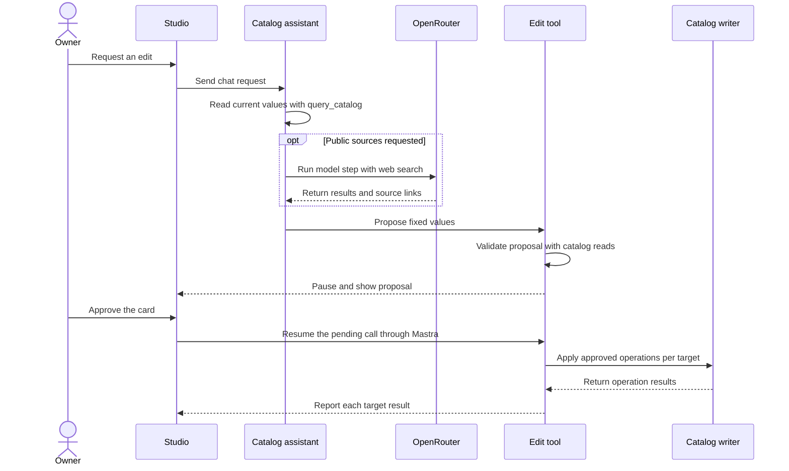

# Design

## TL;DR

- The owner can correct existing catalog records in Studio chat. The catalog assistant reads current values, can find public sources through OpenRouter, and prepares one fixed proposal for the full selection.
- Mastra pauses the edit tool and shows the proposal in an approval card. The owner reviews one pending proposal at a time. The server permits writes only after a native Studio approval.
- The catalog writer applies the approved fields to the current record and commits each Event or Edition as a unit. The tool reports each result. The owner can explicitly omit the audit entry for a direct edit.

See the [proposal](proposal.md) for scope and behavior.

## Contracts

Add `edit_catalog` to the [catalog assistant](../../../src/mastra/catalog-assistant/index.ts). Use the field types from the existing [catalog operations](../../../src/catalog/operations/operation.ts).

```ts
// Proposed edit tool input. Value types come from catalog operations.
type AuditMode = "record" | "omit";
type EditChanges<T> = { [K in keyof T]?: { before: T[K]; after: T[K] } };
type LinkEdit = { id: string; changes: EditChanges<LinkValues> };

type EditProposal = {
  auditMode: AuditMode;
  targets: EditTarget[];
};

type EditTarget = {
  id: string;
  links?: LinkEdit[];
} & (
  | { kind: "event"; changes: EditChanges<EventValues> }
  | { kind: "edition"; changes: EditChanges<EditionValues> }
);
```

Use the complete price or classification set for a replacement. Identify link edits by ID. In the target transaction, apply the approved link changes to the current list before calling `replaceLinks`. Fail the target if an edited link no longer belongs to it. Changing a link URL or kind can change its stored ID. Use `updateEvent` for the full and short descriptions. An omitted field stays in place. An explicit null clears a nullable field.

Keep Event and Edition IDs, Edition keys, link ownership, and publication fields outside the edit set. Retain official Edition link overrides by kind and inheritance of other official Event links.

Extend the [catalog writer](../../../src/catalog/write/apply-operation.ts) for approved edits. Use the approved run ID, tool call ID, and each operation's position in the proposal to derive operation keys. Keep positions fixed for no-ops. Check the receipt against the fixed approved change and audit mode before loading current values for that operation. This keeps replay stable when the version or link list changes. Keep the default writer's receipt hash and keep the actor under server control.

Audit omission suppresses only `CatalogChange` rows. Preserve validation, record versions, URL aliases, and atomic operation receipts. Keep normal ingestion auditing, stale-version checks, and rejection of operation-key reuse with another payload or audit mode. Identical receipts return the saved result after later edits; no-ops add no change entry.

Register the [OpenRouter server tool](https://openrouter.ai/docs/guides/features/server-tools/web-search) on `catalog-assistant`:

```ts
// Proposed Mastra tool definition.
const webSearch = {
  type: "provider-defined",
  id: "openrouter.web_search",
  name: "web_search",
  args: {},
} as const;
```

Mastra sends this definition as `openrouter:web_search` with the function tools. Use the current `prepareStep` hook to filter it from active tools on steps that use another provider. Keep the other active tools and the current provider options. OpenRouter handles the search. Use source URLs from the response in chat.

## Architecture



## Key decisions

- **Use the pending call as the proposal.** Mastra `requireApproval` pauses the call and the native card shows the raw arguments. Validate the arguments and check before values with catalog reads. Require values in their effective form when the writer would otherwise normalize them. Use an explicit rejection because a thrown pre-approval hook can still let Mastra reach the approval gate. Resolve the full selection within the item and byte limits before showing a card. Offer omission only on explicit owner request, and show the mode on the card.
- **Use native Studio approval.** Studio starts a draft through `send-message` in the chat thread. The owner approves or declines each draft before asking for another one. Mastra selects and resumes the pending call through `send-tool-approval`. This flow assumes the owner uses the current card.
- **Check approval at the write entry point.** The edit tool requires server-owned context from a native approval request. Use the native pending run ID and tool call ID for operation receipts. Reject approval requests that supply replacement messages or custom resume data. Use the current trusted Studio access model.
- **Use the existing writer per target.** Apply each target with `applyApprovedCatalogItem` in the shared writer. The proposal carries no version. The shared writer reads the current version in the target transaction after it checks the operation receipt. A change since preview does not block an edit. The writer uses the actual old values for the audit entry and validates the resulting state. Build the report from operation results because a successful edit can omit its audit row. Continue after a target fails.
- **Keep direct editing separate from research.** The owner can approve a valid Edition country correction through this edit path. The existing [refresh country guard](../../../docs/ingestion-process.md) still applies to research. The direct edit uses catalog validation.
- **Keep web search in chat.** Use the provider tool with the existing OpenRouter credentials. Search runs in the model request, separate from the ingestion Reader. Use the existing model traces for that request. Treat search results as source data. Only the owner can request an edit or authorize a write.

## Risks and validation

Use the [offline Studio fixture](../../../src/test/studio-fixture.ts) to check the proposal and its result in the built-in Browser. Approve or decline each proposal before opening the next one.

Use one Studio API test to check a draft, the write after approval, and the default audit entry. Use one writer test to check audit omission, replay, partial success, and public URL aliases.

Check that the installed Mastra adapter sends the search tool alongside `edit_catalog` for OpenRouter and omits it for a direct provider. Verify in Studio that a search result displays its source URL and that a proposed correction still pauses for approval.
