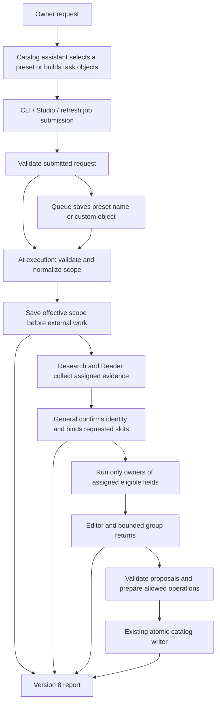

# Design

## TL;DR

- The catalog-assistant selects a shipped preset or builds a typed task list from the owner's request. Each task assigns one target and one or more fields with an optional shared instruction and a required value. Standard field rules apply when the instruction is omitted.
- One validated definition controls collection, Reader extraction, agent assignment, proposals, returns, Editor review, and allowed catalog changes. Unassigned specialists and geocoding do no work.
- Tasks use string targets event, currentOrNext, or latestCompleted. Map Edition selectors to the existing slots and bind each requested slot once from evidence. Repeated target/field assignments are invalid. Each field uses one existing proposal path for checks, Editor review and returns, and reports. Each specialist receives all its eligible tasks in one initial call; existing bounded returns remain available.
- `full`, `current`, and custom scope use the same creation, publication, and source recovery rules. A temporal selector can create a supported Edition. Accepted assigned Editions use normal publication rules. Event-only refresh preserves publication state and needs no Edition.
- Jobs and attempt input retain the submitted preset name or custom object. Resolve that request once when each attempt starts. Save and pass the normalized definition directly before external work. Report version 8 records that definition and target outcomes. Keep version 7 history unchanged.

The [proposal](proposal.md) owns the requirements and acceptance criteria. Current source, review, and catalog rules are described in the [ingestion process](../../../docs/ingestion-process.md) and [source reader](../../../docs/source-reader.md) guides. Keep those rules except for the changes defined here.

## Contracts

The following contracts are proposed. The current input definitions are in [invocation.ts](../../../src/ingestion/invocation.ts) and [contracts.ts](../../../src/ingestion/contracts.ts).

The owner normally gives an ordinary request to the catalog-assistant. The assistant chooses full/current for a matching standard request or builds a typed scope object with research tasks. It submits that scope through the same input validation before ingestion starts. This step is part of the assistant's existing request handling. It adds no separate scope-generation agent. Direct Studio input can also supply the object. The CLI keeps only full/current presets.

```ts
type Preset = "full" | "current";
type EditionSelector = "currentOrNext" | "latestCompleted";
type ScopeTask = {
  instruction?: string;
  required?: boolean;
} & (
  | { target: "event"; fields: EventScopeField[] }
  | { target: EditionSelector; fields: EditionScopeField[] }
);

type ScopeDefinition = {
  version: 1;
  tasks: ScopeTask[];
};
type ScopeRequest = Preset | ScopeDefinition;
```

A small scope can contain one task:

```json
{
  "version": 1,
  "tasks": [
    {
      "target": "event",
      "fields": ["description"]
    }
  ]
}
```

A scope can combine Event work with Edition work:

```json
{
  "version": 1,
  "tasks": [
    {
      "target": "event",
      "fields": ["shortDescription"],
      "instruction": "Summarize the current festival format for a preview."
    },
    {
      "target": "currentOrNext",
      "fields": ["dates", "scheduleStatus"],
      "instruction": "Check the complete programme dates, their year, cancellation and postponement."
    },
    {
      "target": "currentOrNext",
      "fields": ["tickets", "links.tickets"],
      "instruction": "Check full-programme admission, mandatory fees, conditions and the official ticket overview."
    },
    {
      "target": "currentOrNext",
      "fields": ["sizeEstimate"],
      "instruction": "Use a supported participant estimate if one is found.",
      "required": false
    }
  ]
}
```

Edition tasks accept only the two temporal selectors. Saved-ID selection is deferred and fails input validation. Ticket tasks accept only `currentOrNext`. The Event ID stays in the invocation. Scope cannot select another Event.

The field vocabulary reuses the current [proposal groups](../../../src/ingestion/groups.ts). The implementation will own its exact types and validators.

| Entity | Scope fields | Group meaning |
| --- | --- | --- |
| Event | `description`, `shortDescription` | Each text is independent. |
| Event | `links.website`, `links.socials.instagram`, `links.socials.facebook`, `links.socials.youtube`, `links.socials.tiktok`, `links.socials.x`, `links.socials.other` | Each link slot is independent. |
| Edition | `year`, `displayName`, `scheduleStatus`, `sizeEstimate` | Each is a separate field assignment. |
| Edition | `dates` | The complete start/end pair and date certainty. |
| Edition | `classification` | The complete classification replacement under existing rules. |
| Edition | `location` | Venue, address, locality, administrative area, country, and coordinates as one coherent group. It does not include time zone. |
| Edition | `tickets` | The complete ticket block. It does not include the Edition ticket link. |
| Edition | `links.tickets` | The Edition ticket overview link. |

An instruction adds detail to the standard field and role rules. It is optional. A supplied instruction must be nonblank and applies to every listed field. Do not generate placeholder text when it is omitted. The same `required` value applies to every listed field; omission becomes `true`. Use separate tasks when fields need different instructions or required values. Omitted fields are outside the assignment. Each assigned field has its own completion result. A completed check can find no supportable value; it must not invent one. `required: false` permits facts found during other work without adding discovery for that task. Presets retain opportunistic size, detailed address, and precise coordinate work. Existing complete-group and catalog rules still constrain possible updates.

Use the application validators for the typed object. Reject unknown properties, unsupported versions or selectors, non-string targets, scalar tasks, blank supplied instructions, empty task or field lists, fields for the wrong entity, and repeated target/field assignments. This includes repeated fields within one task. Errors identify the submitted input path. Reject tickets or links.tickets paired with latestCompleted before external work. No text parser or new runtime dependency is needed.

The workflow saves and passes the normalized definition directly. Proposed normalization result:

```ts
type NormalizedScope = {
  version: 1;
  tasks: (ScopeTask & { required: boolean })[];
};
```

`NormalizedScope` retains task order, targets, fields, and any supplied instructions. Missing instructions remain omitted. It makes required values explicit. Use the saved submitted request to show the preset name. Tasks with the same selector use one named slot and binding. Field assignments are derived from the tasks for checks and write validation; they are not another editable scope.

Each slot outcome retains a concrete Edition ID/key when established, source support, and any reason that prevents work. A selector is not replaced with a year. The workflow needs no separate list of Edition requests, planner, scope database, or hash registry.

The external request accepts a preset name or the custom object. Studio, refresh job submission, and the worker use the same request validator. The CLI keeps `--scope full|current` with full as the default. A custom CLI file option is deferred. The effective definition is internal to an attempt; it is not another external input form.

## Architecture



Input normalization owns required defaults, preset expansion, field assignment, and requested slot permissions. Submission validates custom tasks before accepting a batch. Execution repeats scope validation before creating an attempt. Existing catalog context and baseline checks keep their current order. Existing context and size limits apply to the complete scope. Detectable oversize input fails before research; no task list is shortened or split into extra runs.

Extend the owner mapping in [groups.ts](../../../src/ingestion/groups.ts) to derive assigned checks, allowed fields, applicable specialists, and review paths from the definition. Reuse that mapping for proposal validation. Replace the current full/current branches in [assignment.ts](../../../src/ingestion/roles/assignment.ts), [workflow.ts](../../../src/ingestion/workflow.ts), and specialist input construction. Keep `mode` for add identity, duplicate handling, and its existing Edition prerequisite.

Use each proposal group's existing `path` as its field key for collection checks, interpretation checks, Editor review and returns, and reports. Examples are `event.fields.description`, `event.fields.links.website`, and `currentOrNextEdition.fields.dates`. Repeated uses of one selector keep the same slot keys regardless of task order. Derive these keys from the registry. Remove the fixed named-check lists and the mapping between field paths and check aliases. Selection uses `currentOrNextEdition.select` or `previousEdition.select`; the Event identity guard keeps `identity`. Keep these guards separate from field checks. Keep collection and interpretation findings separate under the same field key. A completed interpretation does not clear an unread or blocked required source check. One completed field cannot complete the other fields in its task. Unassigned fields create no missing checks. Existing country diagnostics remain part of the guards.

Research and the first Reader call receive scope before navigation starts. Derive each stage's relevant tasks and boundaries from the one fixed definition. Apply standard field rules when an instruction is omitted. Keep supplied instructions attached to their fields; a rendered stage input grants no new permissions. Reader keeps the existing whole numbered page and literal segment binding. It extracts requested evidence and the context needed for identity, target selection, source meaning, or an observed country contradiction. Scope does not crop stored pages, remove qualifications, or make page silence prove absence.

General confirms the targeted Event, applies existing country guards, and resolves each requested temporal slot once. For an Event-only scope it does no temporal selection. Saved facts provide context; they do not prove a temporal role. Ticket tasks use only the currentOrNext binding.

After target validation, all later calls receive the original boundaries and concrete bindings. Keep the two named slots across General, specialists, Location point references, proposal paths, returns, Editor, and catalog preparation. Invoke each assigned owner once in the initial pass with all its eligible tasks and targets. Existing bounded returns can call an owner again. A task is not a new agent call, transaction group, or complete workflow.

Build specialist inputs and output schemas from assigned fields. For description-only work, Classification receives descriptions and relevant evidence without Edition taxonomy or vocabulary. Tickets, Links, Location, and initial geocoding do not run. For link-only work, Links runs without Tickets. Editor can return only assigned groups and cannot add a field or rebind a target. Keep the existing return allowance, selective saved-page checks, evidence IDs, and original-versus-returned-group validation rules.

Proposal preparation validates allowed targets and groups. Catalog preparation checks effective changes against the assignment and the shared execution rules before calling the existing operations. For replacement operations, compare logical changes rather than treating preserved sibling links as new assignments. Preserve existing version, country baseline, donor, and transactional validation. A scope violation or invalid final item prevents all item writes. An ordinary unresolved target or fact can leave independent supported work eligible.

## Key decisions

### Use typed tasks and a fixed field vocabulary

The existing refresh tool already takes a typed object, and jobs already store JSON. Use that path directly. A task can give dates and scheduleStatus one optional research instruction without repeating the text per field. Standard field and role rules define ordinary work. The assistant adds an instruction only when the request needs more detail. Code derives exact field permissions and checks. Instructions cannot add fields or targets, override execution rules, or serve as source proof.

Free text with a field list is shorter, but leaves different instructions for several Editions to model interpretation. A separate text language would add parsing and documentation without a current manual-file consumer. Keep one object format, deterministic normalization, and agent ownership in code. No extra model call is needed to compile scope.

The optional `required` property preserves opportunistic fields without turning absence into new searches or partial results. Split tasks when only some fields are optional. Do not add a scalar shorthand, instruction override levels, or scheduling syntax.

The three string targets identify the entity and, for Edition work, its temporal role. Validate fields for that entity. No nested selector object is needed while saved-ID selection is deferred.

### Bind selectors once and keep field permissions separate

Temporal selectors use the existing inspected-evidence, frozen-date, uncertainty, and durable-key rules. Selection can need dates, country, or programme context even when those fields are not writable.

Reuse the two slots already used by General and specialist contracts:

| Selector | Existing slot |
| --- | --- |
| latestCompleted | previousEdition |
| currentOrNext | currentOrNextEdition |

Use the selector names through this fixed slot mapping for target references in agent inputs, proposals, Editor returns, checks, and reports. Do not add `requestId` or use task or target array positions as target references. Task order does not identify a target. Input error paths can use array positions to locate invalid values.

Several tasks may use the same selector with different fields. They share that slot's fixed binding. Reject a repeated field for that target even if its instruction is identical; tasks do not override each other. Retain the guard against both slots binding to the same Edition.

The owner has deferred saved-ID selection. Research of an arbitrary saved Edition is unavailable in this change. This keeps current role, Location, proposal, return, and writer target contracts. It avoids a general target array and the related conversion of paths, point references, and fixtures. Existing Edition IDs and durable keys still identify the selected catalog record internally.

Historical ticket extraction remains outside this change. Tickets and links.tickets require currentOrNext. Reject latestCompleted for those fields before external work. If scope omits a field needed for a valid update, do not add it. Report the dependency or reject an invalid final proposal. For example, clearing dates on a scheduled Edition can require an explicitly assigned scheduleStatus change.

### Express presets as task data

Ship full/current as typed task definitions and use the same validators and field registry as custom scope. The definition contains only tasks and their scope version. After expansion, task data and shared execution rules control behavior. A preset name grants no extra behavior. An adjusted preset becomes a complete custom object before submission; no saved preset override language is needed.

| Assignment | Event tasks | Edition selectors |
| --- | --- | --- |
| Full preset | Both descriptions and all supported shared link slots | latestCompleted and currentOrNext |
| Current preset | None | currentOrNext |
| Custom scope | Only listed fields | Only listed selectors |

Full retains all currently supported Edition tasks except historical tickets and ticket links. Current retains its current mandatory checks and opportunistic work. Both presets retain discovery limits, country refusal, stable keys, publication eligibility, withdrawn-record controls, and evidence rules for confirmed absence. Source recovery and work without an Edition follow the shared rules below. These are approved changes to legacy preset behavior.

Add uses the full task definition internally with its existing identity, Edition prerequisite, creation, and publication rules. It still rejects an external scope. Sharing the definition does not make add a refresh or permit it to update duplicates.

### Use shared execution rules

The owner has accepted one set of rules for every refresh. Do not add effect flags to submitted scope, expanded presets, or stored effective scope. Do not keep preset-name branches for these rules. The catalog preparation layer enforces creation and publication. Research applies the same source recovery rule to every assignment.

A selected temporal target can reuse a saved Edition or create a supported Edition under the fixed Event when assigned facts satisfy the existing creation rules. Creation keeps existing record defaults and identity metadata. It does not collect or set omitted facts to complete the record. If the assigned facts cannot support creation, report the dependency as unresolved and keep independent supported work eligible. An invalid final proposal still prevents all item writes.

Apply normal publication eligibility to accepted assigned Edition targets, including a target that needs no fact changes. Publication can also publish the parent Event under existing catalog rules. Do not evaluate unrelated saved Editions for publication. A scope with only Event tasks preserves publication state, even when a saved Edition is already published. Preview and the separate republish control remain stronger limits. Queue and chat keep republish off.

Research can recover a correct official source when an assigned task needs it. Use the existing discovery limits and identity evidence rules. Recovery alone permits no catalog write. The saved website can change only when `event.fields.links.website` is assigned. Current therefore no longer stops only because source recovery needs a full refresh.

Remove the selected-or-qualifying-saved Edition gate from refresh. General resolves only assigned selectors. An absent or unresolved Edition does not block independent supported Event work. Full can therefore save Event facts without a usable Edition. Current with no usable target makes no catalog changes; the report distinguishes confirmed absence from unfinished required work. Identity uncertainty and country conflicts still stop the whole Event. An observed country contradiction cannot be ignored because location is unassigned; no extra Location or geocoding call is needed to keep this guard. Add retains its existing Edition prerequisite.

Custom scope cannot separately request updates without automatic publication or temporal selection without possible creation. This removes controls for combinations that the owner has not needed. It also removes separate defaulting, persistence, and validation for those controls. Fields, selectors, and existing catalog rules define the allowed work.

### Save the request and the scope used by each attempt

Jobs and attempt input retain the submitted `ScopeRequest`: a preset name or the custom object. Job dispatch and the existing attempt transaction compare that request, Event, and preview setting with the accepted job. Compare object values, including task order, fields, instructions, and required values, rather than object identity. Queue and chat keep republish off.

Each attempt expands a preset from the deployed definition available at its start. A retry creates a new attempt and can use a newer preset. Legacy name-only jobs follow this same path without rewriting their input or settings. No fixed legacy preset adapter is needed.

For custom scope, each attempt validates the saved object without asking an agent to rebuild it. Apply the scope version's validation and required defaults. Unsupported versions or selectors fail before external work; do not adapt the assignment silently. Saving the object preserves its tasks, fields, supplied instructions, and required values. Missing instructions remain omitted. It does not freeze source facts or temporal selection: those still use the attempt's frozen date and current evidence.

Save `NormalizedScope` directly in attempt input before external work. Keep it separate from the submitted request; preset origin comes from that request. All stages and returns use that one normalized definition. Later preset edits cannot change a running attempt or its stored history. Use the existing JSON input fields; no catalog record or table schema migration is needed.

Generate report version 8 because scope and check-key meanings change. It records the normalized definition directly, outcomes under the two existing slot names, existing proposal paths as field keys with separate collection and interpretation findings, and skip reasons. A failure before selection records that selection did not run; it does not invent absence. Keep duration and trace correlation; existing optional observability owns model and search costs. Update Studio SQL guidance and evaluation consumers for version 8. Inspect version 7 with its original named checks without converting it.

## Risks and validation

| Risk | Focused validation |
| --- | --- |
| A preset loses work outside the approved changes | Use existing full/current fixtures to compare field coverage, required checks, optional work, and outcomes under the shared rules. Keep add results unchanged. |
| Scope reaches only late stages | Capture inputs for the first Reader, Research, General, each assigned specialist, Editor, and a return. Assert standard field rules without an instruction, unchanged supplied instructions, boundaries, frozen date, and later bindings. |
| Unrelated work still runs | In a description-only fixture, assert no Edition selection tasks, ticket/link/location calls, geocoding, or discovery for those fields. In a link-only fixture, assert no ticket model call. |
| A model expands the assignment | Supply out-of-scope original proposals, target swaps, publication outside accepted Edition targets, and an Editor return for another field. Verify no catalog, audit, or receipt changes. |
| Shared rules change the wrong records | Verify temporal creation with sufficient assigned facts, unresolved creation dependencies, normal publication of assigned Editions, Event-only publication preservation, needed source recovery without a website write, full without Editions, and current without a usable target. |
| A selector uses saved state as proof | Reuse date-boundary, cancellation, ambiguous-order, corrected-key, same-year, and same-Edition slot guard fixtures. |
| Task grouping changes the assignment | Use several tasks for one selector with different fields and required values. Verify one binding and stable slot keys regardless of task order. Reject repeated target/field assignments within and across tasks. |
| An invalid task starts external work | Reject non-string targets, scalar tasks, fields for the wrong entity, unsupported selectors, blank supplied instructions, and ticket tasks paired with latestCompleted before an attempt or provider call. |
| A check hides unfinished work | Verify independent paths for description and shortDescription. Each field keeps its existing proposal path through collection, interpretation, Editor returns, and reports. Completing one field in a shared task must not complete another. A completed interpretation must leave an unfinished required source check visible. |
| A partial task blocks independent work or evades a guard | Exercise Event-only work with no Editions, mixed description/unresolved-Edition work, and observed or concurrent country conflicts. |
| A job or attempt uses the wrong scope | Change a preset after submission. Verify the next attempt uses the new definition and keeps it fixed through returns. Retry a custom job and verify its task values and order are unchanged, including omitted instructions. Check legacy name-only jobs and unchanged prior attempts. |

Deploy input adapters, worker, agent contracts, and report guidance together in the existing single-Studio setup. An older worker cannot process custom scope objects. Keep a pre-deploy backup and stop queue processing before a rollback that removes the new input contract.

Use deterministic source fixtures for required checks. A manual model comparison can then run full/current and narrow scopes on the same inputs with the same model. Inspect native calls, tokens, search cost, and outcome quality. No fixed savings threshold is required: Reader still receives whole pages, and selection can still need substantial evidence. Page-content deduplication, smaller models, and reuse across runs are separate changes.
